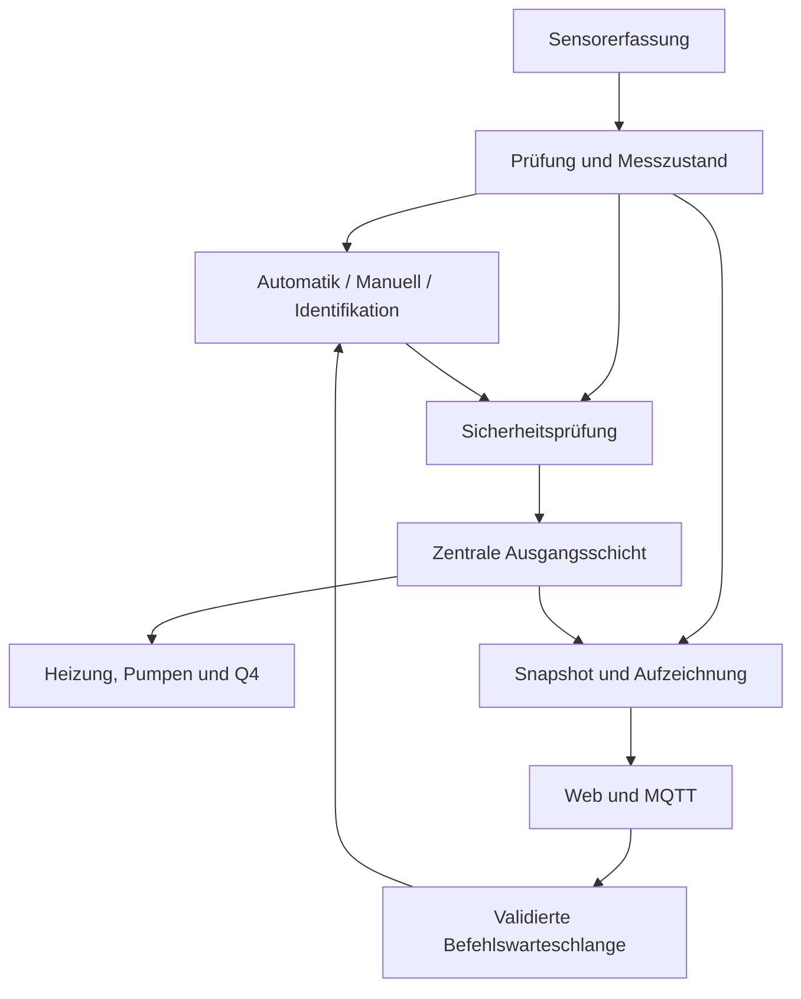

# Softwareentwurf Klimaregelung

## Implementierungsspezifikation für ESP32, Visual Studio Code und PlatformIO

| Eigenschaft | Festlegung |
|---|---|
| Projekt | Klimaregelung des Rückzugsraums im Kaninchenstall |
| Dokument | Softwareentwurf v1.0 |
| Stand | 25. November 2026 |
| Ziel | Grundlage für die anschließende Implementierung und Prüfung der Firmware |
| Quellen | Pflichtenheft v1.3, PCB-Pinout v0.7 und die abschließenden Nutzerentscheidungen vom 25.11.2026 |
| Zielhardware | Klassischer ESP32-DevKitC/WROOM mit externer Antenne; konkrete Modulrevision und Flashgröße noch am Gerät bestätigen |
| Entwicklungsumgebung | VS Code, PlatformIO, C++, Arduino-ESP32 |
| Lieferumfang dieses Dokuments | Architektur, Algorithmen, Zustandsübergänge, Datenhaltung, Web/API/MQTT, Parameter, Abnahmekriterien |
| Status | Implementierbarer Entwurf; noch fehlende Inbetriebnahmewerte sind ausdrücklich gekennzeichnet |

**Vorrangregel:** Die abschließenden Nutzerentscheidungen werden durch dieses Dokument konkretisiert. Bei den unten ausdrücklich genannten Änderungen ersetzt dieser Entwurf die entsprechenden älteren Softwareanforderungen aus dem Pflichtenheft v1.3. Übrige Anforderungen bleiben bestehen. Das PCB-Pinout v0.7 bestimmt die elektrischen Anschlussbezeichnungen. Dieses Dokument ändert keine reale Verdrahtung und stellt keine bereits erfolgte Hardwareprüfung dar.

Die Wörter **muss**, **darf nicht** und **verbindlich** kennzeichnen Implementierungsanforderungen. Als **Entwurfsdefault** bezeichnete Zahlen sind vorgeschlagene Softwarevoreinstellungen, keine nachgewiesenen sicheren Betriebsgrenzen. Die Quellen und Herstellerdokumentationen stehen in Abschnitt 22.

## 1. Getroffene Entscheidungen und Abgrenzung

| Thema | Verbindliche Entscheidung |
|---|---|
| Firmware | Eine gemeinsame Firmware für Automatik, manuelle Bedienung und Systemidentifikation; keine separate Einrichtungsfirmware |
| PI-Regelgröße | Median aller vom Benutzer aktivierten Plattensensoren |
| Sicherheitsgröße | Maximum derselben aktivierten Sensoren; keine statistische Ausreißerunterdrückung im Sicherheitskanal |
| Sensorfehler | Kein automatischer Ausschluss. Ein Fehler eines aktivierten Plattensensors führt zur Abschaltung und erfordert Bedienereingriff |
| Sensor deaktivieren | Nur ausdrücklich im Setup; ROM-Zuordnung und Aktivierungsmaske werden dauerhaft gespeichert |
| Plattenobergrenze | Feste Konstante im Code; im Debug sichtbar; weder über Web/API noch MQTT änderbar |
| Andere Betriebsparameter | Im Setup innerhalb der definierten Typ-, Bereichs- und Konsistenzprüfungen einstellbar |
| Heizstromgrenze | Geschätzter **mittlerer Heizstrom auf VIN-Ebene**, ausschließlich Heizdrahtanteil; keine RMS-Stromvorgabe |
| Widerstand | Statischer, manuell gesetzter Heizdrahtwiderstand; keine automatische Anpassung und kein zusätzlicher dynamischer Mindestwiderstand |
| Heizleistung/Energie | Modellrechnung aus gemessenem VIN, statischem Widerstand und effektivem PWM-Tastgrad |
| Funktionsfreigaben | Separate dauerhafte Freigaben für Hauptheizung, Plattenkühlung und Verdunstungskühlung |
| Web | Lokale Info-Seite `/`, Setup-Seite `/setup`, lesende Debug-Seite `/debug`; sämtliche Assets lokal |
| MQTT | Implementiert, zunächst deaktiviert; im Setup konfigurierbar und ohne Firmwarewechsel aktivierbar |
| MQTT-Inhalt | Telemetrie einschließlich aller Sensoren, Ausgänge, Leistung, Energie, Fehlerflag und Fehlertext |
| Sprungantwort | Heizphase 1–500 min; Vorlauf und Nachlauf unabhängig jeweils 0–60 min; Messraster 10 s |
| Testdaten | Sieben CSV-Spalten einschließlich Zeit; kein Qualitätsfeld pro Messzeile; nur vollständige gültige Messpunkte |
| Testablage | Ein Test; ein erfolgreich gestarteter neuer Test ersetzt den vorherigen |
| Testende / PI-Änderung | PWM und Integrator auf 0, danach Automatik neu starten, sofern keine Sperre besteht |
| 24-h-Historie | Ein Wert je 10 min, ausschließlich RAM, Neubeginn nach Neustart |
| Fehlerhistorie | Ausschließlich RAM; kein NVS-Fehlerarchiv |
| Konfigurationsjournal | Nicht vorgesehen |
| Messspeicher | Kleiner RAM-Schreibpuffer und LittleFS im internen Flash; keine externe SD-Karte |
| Energiezähler | Laufende Integration im RAM; periodischer dauerhafter Checkpoint in NVS |

### 1.1 Bewusste Änderungen gegenüber Pflichtenheft v1.3

Ersetzt werden insbesondere:

- Mittelwert als PI-Regelgröße durch Median (§7/8 des Pflichtenhefts).
- Automatische Weiterrechnung mit einer verbleibenden gültigen Teilmenge durch ausdrücklich manuelle Sensorfreigabe (§7/9.6/12).
- Die bisherige feste 36-/60-W- beziehungsweise zusätzliche qualifizierte Tastgradgrenze durch die konfigurierbare VIN-Heizstrombegrenzung dieses Entwurfs. Die früheren Leistungswerte bleiben Rechenbeispiele, keine parallelen Softwaregrenzen.
- Die Pflicht, alle neun Einzeltemperaturen und zahlreiche Nebenwerte je Testmesspunkt zu archivieren, durch den schlanken Datensatz aus Abschnitt 11.
- Eine frei definierbare Q4-Stützpunktkennlinie durch die lineare Außenluftkennlinie.
- Die bisher geforderte unabhängige thermische Abschaltung wird **nicht Bestandteil dieser Implementierung**. Die vorhandenen Plattensensoren veranlassen die softwareseitige Abschaltung; die daraus entstehenden Grenzen stehen in Abschnitt 6.5.
- MQTT-Konfigurations- und Aktorbefehle werden für eine spätere Erweiterung vorbereitet, sind in Version 1.0 aber nicht freigeschaltet. Die jetzt umzusetzende MQTT-Funktion ist Telemetrie.

### 1.2 Warum Median und optionale Vor-/Nachläufe?

Bei fester Sensormenge und stetigen Eingangssignalen ist auch der Median stetig. Ein Rangwechsel allein erzeugt keinen Temperatursprung, weil die wechselnden Werte am Übergang gleich sind. Der Verlauf kann seine Steigung ändern. Diskrete Messung, Messfehler oder eine manuell geänderte Sensormenge können dagegen Sprünge verursachen.

Der Mittelwert bildet eine räumlich gemittelte Temperatur besser ab und kann unabhängiges Messrauschen glätten. Der Median entspricht hier der gewünschten robusten repräsentativen Plattentemperatur. Er erkennt jedoch keine Sensorfehler und ersetzt weder Messgültigkeitsprüfung noch Maximumüberwachung.

Ein Vorlauf zeigt Anfangstrend und Ausgangsniveau. Ein Nachlauf liefert zusätzliche Information über Abkühlung und Zeitkonstante. Beide sind hilfreich, aber nicht für jeden Fit zwingend; deshalb bleiben 0 min zulässig. Es werden dabei dieselben sieben Werte gespeichert, keine zusätzlichen Messkanäle. Selbst der maximale Versuch benötigt nur rund 116,3 KiB reine 32-Byte-Datensätze.

## 2. Zielhardware und Plattform

### 2.1 ESP32 mit externer Antenne

Die Projektquellen belegen einen klassischen ESP32-DevKitC/WROOM, aber keine konkrete Antennenvariante. Als Zielannahme für den Softwareaufbau dient ein **ESP32-DevKitC-32UE mit ESP32-WROOM-32UE**, 4 MB Flash und ohne PSRAM. Espressif dokumentiert diese Variante mit externem Antennenanschluss [E1]. Ein vorhandener ESP32-WROOM-32U beziehungsweise ein kompatibles Drittanbieterboard kann ebenfalls passen; Modulaufdruck, Pinbelegung und Flashgröße sind vor dem ersten Hardwarebuild zu bestätigen.

Die externe Antenne ist eine Hardwareeigenschaft. Es gibt hierfür in diesem Entwurf keinen erfundenen allgemeinen Softwareparameter `external_antenna`. Antennenanschluss beziehungsweise Antennenpfad müssen am realen Board passend ausgeführt sein. PSRAM wird nicht vorausgesetzt.

### 2.2 Verbindliche Pinzuordnung

| Funktion | GPIO | Ansteuerung | PCB-Bezug |
|---|---:|---|---|
| Hauptheizung | 18 | LEDC, 20 kHz, 10 Bit, HIGH = EIN | U6 Kanal A → Q1 → J1 |
| Kühlkreispumpe | 23 | Digital, HIGH = EIN | Q2 → J4, 12 V |
| Verdunstungspumpe | 19 | Digital, HIGH = EIN | U6 Kanal B → Q3 → J5 |
| Gate-Treiber-Zusatzheizung | 33 | 1-Hz-Zeitproportionierung | Q4, Netz `Heat_PWM` |
| Plattensensoren | 13 | Eigener 1-Wire-Bus, neun DS18B20 | U8 / `DATA_Plate` |
| Tanksensor | 14 | Eigener 1-Wire-Bus, ein DS18B20 | U9 / `DATA_Tank` |
| I²C SDA | 21 | 100 kHz als Startwert | SHT45 und beide BME280 |
| I²C SCL | 22 | 100 kHz als Startwert | SHT45 und beide BME280 |
| VIN | 34 | ADC1_CH6 | 150-kΩ-/10-kΩ-Teiler, nominal Faktor 16 |
| Reserve | 32 | Nicht verwendet | Kein Gehäuse- oder Treibertemperatursensor vorhanden |

Adressen: Rückzugsraum/SHT45 `0x44`, Außen/BME280 `0x76`, Stall/BME280 `0x77`. Die beiden BME280-Adressen sind am Aufbau zu bestätigen. 1-Wire- und I²C-Datenpegel sind 3,3 V. DS18B20 werden extern versorgt, nicht im Parasite-Power-Modus.

**Festgelegte Pumpenzuordnung:** GPIO19/Q3/J5 ist die Verdunstungspumpe. Bei 24-V-Einspeisung muss J5 über J2 aus 12 V versorgt werden; J3 und J7 bleiben offen. Die Firmware besitzt keine Jumpererkennung. Diese Angaben folgen PCB v0.7, ergänzt um die jetzt entschiedene Funktion von Q3/J5 [P2].

### 2.3 Reproduzierbare Entwicklungsbasis

Als konkrete Ausgangsversion wird `platformio/espressif32@6.13.0` festgelegt. Deren Arduino-Framework ist Arduino-ESP32 **2.0.17**, basierend auf ESP-IDF **4.4.7** [E2]. Dies ist ein bewusst gepinnter Ausgangsstand, keine Behauptung, die jeweils neueste Version zu sein.

```ini
[env:klima_esp32]
platform = platformio/espressif32@6.13.0
board = esp32dev
framework = arduino
monitor_speed = 115200
board_build.filesystem = littlefs
; Nach Bestätigung der Flashgröße und des OTA-Umfangs aktivieren:
; board_build.partitions = partitions_klima.csv
build_unflags = -std=gnu++11
build_flags = -std=gnu++17
```

`esp32dev` ist das generische klassische ESP32-Profil mit 4-MB-Vorgabe [E3]. Die endgültige Partitionstabelle darf nicht allein aus diesem Profil auf die reale Flashgröße schließen. WLAN/MQTT/Passwörter gehören nicht in ein veröffentlichtes `platformio.ini`.

Für diesen Core verwendet der PWM-Adapter `ledcSetup`, `ledcAttachPin` und kanalbezogenes `ledcWrite`. Das Core-3.x-Beispiel `ledcAttach(pin, ...)` aus der PCB-Datei darf nicht unverändert übernommen werden. Ein späterer Core-Wechsel erfordert eine bewusste Anpassung des Hardwareadapters [E4].

## 3. Architektur und Verantwortlichkeiten

### 3.1 Daten- und Stellpfad



**Nur die zentrale Ausgangsschicht darf GPIO/PWM ändern.** Webserver, MQTT, PI, Kühlungslogik und Testmanager liefern Anforderungen. Die Sicherheitsprüfung bleibt auch im manuellen Modus und während der Identifikation wirksam.

| Modul | Verantwortung |
|---|---|
| `BoardConfig` / `HardwareLimits` | GPIOs, PWM-Grunddaten, feste Plattenobergrenze |
| `SensorManager` | Terminierte Buszugriffe, ADC, einheitliche Messzeitstempel |
| `PlateSensorManager` | ROM-Zuordnung, aktive Maske, vollständiger Plattensatz, Statistik |
| `ClimateCalculations` | Örtliche Taupunkte, Regelungsfallback, Feuchtkugeltemperatur |
| `ControlManager` | Exklusive Steuerquelle, Automatikzustände, Übergänge |
| `PIHeatingController` | PI in Tastgradeinheiten, Anti-Windup, definierter Nullstart |
| `CoolingController` / `EvaporationController` | Pumpenanforderungen und Hysteresen |
| `DriverHeaterController` | Q4-Kennlinie und Freigabe |
| `SafetyManager` | Fehler, Grenzen, globale und funktionsbezogene Sperren |
| `ActuatorManager` | Verriegelung, PWM-Quantisierung, einzige physische Ausgabe |
| `ManualControlManager` | Zeitbegrenzte manuelle Sitzung |
| `IdentificationManager` | Vorlauf, Sprung, Heizphase, Nachlauf, Abbruch |
| `MeasurementRecorder` | Gültige Messpunkte, LittleFS, Wiederherstellung, CSV |
| `HistoryManager` | 24-h-RAM-Ringpuffer |
| `EnergyCounter` | Energieintegration und NVS-Checkpoints |
| `ConfigurationManager` | Parameterregister, Validierung, atomare Übernahme, NVS |
| `FaultManager` | Aktuelle Fehler, Quittierung, RAM-Historie, Fehlerflag/-text |
| `WebServerManager` / `MqttManager` | Darstellung, Telemetrie, validierte Befehle |
| `WiFiManager` / `TimeService` | Nicht blockierende Verbindung, monotone Zeit, optionale Uhrzeit |

### 3.2 Nebenläufigkeit und Laufzeiten

Vorgesehen sind eine priorisierte Steuerungs-/Sicherheitstask, eine Sensortask sowie niedriger priorisierte Netzwerk- und Speichertätigkeiten. Daten werden als kurze unveränderliche Snapshots übergeben. Kein Modul hält eine Sperre während Bus-, Netzwerk- oder Dateizugriffen.

| Funktion | Entwurfsintervall / Regel |
|---|---|
| Haupt-PWM | Hardware, 20 kHz |
| Steuerungstask | 10-ms-Tick; Q4-Zeitfenster und anstehende Befehle bearbeiten |
| Sicherheitsbewertung | Sofort nach neuem Mess-/Fehlerereignis und spätestens alle 100 ms auf bekannte Zustände prüfen |
| DS18B20 / Klimasensoren | Alle 2 s; Konvertierung und Abholung getrennt |
| VIN | Aktualisierter Wert alle 100 ms, mit kurzer ADC-Mittelung |
| PI | Alle 5 s, tatsächliches monotones Δt verwenden |
| Q4 | Kennlinie jede Sekunde; Ausgangsfenster 1 s, Auflösung 10 ms |
| Testaufzeichnung | Alle 10 s |
| Normale Historie | Alle 600 s |
| Leistung/Energie | Mindestens jede Sekunde sowie bei jeder Ausgangsänderung |
| Web-Livewerte | Abruf alle 2 s, Testfortschritt jede Sekunde |
| MQTT-Telemetrie | Default 10 s, Zustands-/Fehlerwechsel zusätzlich zeitnah |
| Energiecheckpoint | Default alle 15 min, sofern Zähler verändert |

Die 100 ms sind ein Schedulerziel ab vorliegender Information, keine Garantie, dass ein physisches Temperaturereignis innerhalb 100 ms erkannt wird. Sensorintervall, Konvertierung, Buszugriff und Laufzeitverzögerungen kommen hinzu. Bei 12 Bit kann eine DS18B20-Konvertierung bis 750 ms dauern [E5].

Eine Storage-Task oder der zweite Core beseitigt Flashlatenzen nicht: Beim klassischen ESP32 können Flashoperationen beide Cores und nicht IRAM-sichere Interrupts zeitweise anhalten [E6]. Deshalb: kleine begrenzte Schreibblöcke, keine Dateisystemformatierung oder Firmware-/Asset-Uploads bei aktiven Hauptaktoren, Laufzeitmessung unter Last. Die Hardware-PWM läuft während einer CPU-Pause mit dem letzten Wert weiter. Eine garantierte unabhängige Abschaltzeit wird nicht behauptet.

### 3.3 Speicher- und Befehlsdisziplin

- Steuerungsdaten, Queues und Historien erhalten feste Obergrenzen.
- Kein Aufbau großer `String`-Objekte und keine JSON-/CSV-Gesamtkopie im Regelpfad.
- Normalbefehle: begrenzte Queue, eindeutige Request-ID, Rückmeldung über Ergebnis.
- Stop und Funktions-AUS: separates priorisiertes Signal; darf nicht an einer vollen normalen Queue scheitern.
- Neue Stellanforderungen gelten nur innerhalb ihrer aktuellen Sitzung und Konfigurationsrevision.
- Bei Überlast darf Telemetrie ausfallen. Sicherheits- und Testdatenfehler dürfen nicht still verworfen werden.
- Der Watchdog wird aus tatsächlich voranschreitenden Tasks bedient, nicht durch eine unabhängige Schleife, die einen blockierten Regler verdeckt.

## 4. Gemeinsames Datenmodell

### 4.1 Messwerte und Konfiguration

Jeder Messkanal führt intern mindestens `value`, `valid`, `sample_time_us`, `sequence` und `error_code`. Das gilt auch dann, wenn in der Test-CSV keine Gültigkeitsspalten erscheinen. Fehlerhafte JSON-Messwerte werden als `null` ausgegeben; ein letzter guter Wert darf nur ausdrücklich als veraltet dargestellt werden.

```cpp
struct PlateSensorConfig {
    uint64_t rom_id;
    bool assigned;
    bool enabled;             // Nur vom Benutzer veränderbar
};

struct Sample {
    float value;
    uint64_t sample_time_us;   // Monoton, Zeitpunkt der Messung
    uint32_t sequence;
    bool valid;
    uint16_t error_code;
};

struct PlateStatistics {
    float median_c, mean_c, min_c, max_c, spread_k;
    uint16_t enabled_mask;     // Bits 0..8
    uint8_t enabled_count;
    bool complete;            // Alle aktivierten Sensoren gültig/frisch
};
```

Der `SystemSnapshot` umfasst alle zehn DS18B20, die drei Klima-Messgruppen, VIN, Plattenstatistik, Sollwerte, PI-Zustand, angeforderte und effektive Ausgänge, Strom-/Leistungsschätzung, Energie, Modus, Fehler, Konfigurationsrevision und Teststatus. Zusätzlich besitzt er `snapshot_sequence`, `boot_id`, monotone Zeit und optionale UTC-Zeit.

Ein Snapshot ist ein konsistent kopierter Zustand. Unterschiedliche Sensoren messen nicht physikalisch gleichzeitig. Ihre individuellen Zeitstempel müssen deshalb erhalten bleiben; die Aufzeichnung verwendet nur frische Werte innerhalb des zulässigen Zeitfensters.

### 4.2 Ausgangsmodell

Mindestens unterscheiden:

- `heater_duty_requested`: Regler-/Bedienwunsch, normiert 0–1.
- `heater_duty_limit`: aktuell errechnete zulässige Grenze.
- `heater_duty_effective`: nach Begrenzung und Quantisierung tatsächlich programmierter Hardwaretastgrad.
- `pump_cooling_commanded`, `pump_evaporation_commanded`: programmierter Ausgangszustand.
- `driver_heater_duty_effective`: wirksame Q4-Zeitproportionierung.
- `heater_input_current_est_a`, `heater_power_est_w`: Modellwerte.
- `inhibit_reasons`: maschinenlesbare Sperrgründe.

„Effektiv“ und Pumpenstatus bezeichnen die Ausgabe des Controllers. Ohne Rückmeldesensor wird weder die reale MOSFET-Funktion noch Pumpenlauf/Förderstrom nachgewiesen.

## 5. Sensorverarbeitung und manuelles Deaktivieren

### 5.1 ROM-Zuordnung und Grid

Positionen sind dauerhaft `P1...P9`, zeilenweise von links oben nach rechts unten. Die UI zeigt eine feste Orientierung, beispielsweise „Ansicht von oben, Eingang unten“. Die tatsächliche Einbaurichtung ist bei der Zuordnung zu bestätigen.

- Eine 64-Bit-ROM-ID darf höchstens einer Plattenposition zugeordnet sein.
- Ein aktivierter Platz benötigt eine zugeordnete ROM-ID.
- Bus-Scan-Reihenfolge ist niemals die Zuordnung.
- Neue unbekannte Sensoren erscheinen als „nicht zugeordnet“ und werden nicht automatisch in die Regelung übernommen.
- Der Tanksensor erhält ebenfalls eine feste ROM-Zuordnung, aber keine Plattenposition.
- Scan und Sensorwechsel finden bei ausgeschalteten Hauptaktoren statt; ein laufender Test muss zuerst beendet werden.

### 5.2 Auswertemenge und Gültigkeit

Die Auswertemenge ist **exakt die vom Benutzer aktivierte Menge**. Es gilt nicht „nimm alle zufällig gültigen Werte“.

Ein neuer vollständiger Plattensatz darf nur dann Regelwerte liefern, wenn alle aktivierten Sensoren den Messzyklus fehlerfrei abgeschlossen haben und frisch sind. Ungültig sind unter anderem fehlende Antwort, CRC-/Busfehler, fehlende abgeschlossene Konvertierung, nicht endliche Werte, Werte außerhalb des spezifizierten Messbereichs oder überschrittenes Messwertalter.

Keine automatische statistische Ausreißerelimination, keine automatische Maskenänderung, kein Ersatz eines defekten Sensors durch einen anderen und kein automatischer Rückgriff auf ältere Werte als aktuelle Regelwerte.

Ein hoher technisch gültiger Wert bleibt in `plate_max`, auch wenn der Median deutlich niedriger ist. Ein gültiger 85-°C-Wert darf nicht pauschal weggefiltert werden: 85 °C ist auch ein Einschaltregisterwert des DS18B20, deshalb muss der Konvertierungszustand geprüft werden. Entweder entsteht ein Sensorfehler oder ein echter Grenzfall; beides darf keine unbemerkte Heizfreigabe ergeben [E5].

### 5.3 Statistik

Für einen vollständigen aktivierten Satz:

- `median`: sortierter mittlerer Wert; bei gerader Anzahl Mittelwert der beiden mittleren Werte.
- `mean`: arithmetischer Mittelwert.
- `min`, `max`: Extremwerte.
- `spread = max - min`.

Bei einem unvollständigen Satz sind die aggregierten Regelwerte ungültig. Einzelne neu empfangene hohe Werte werden trotzdem sofort auf die feste Obertemperatur geprüft; die Prüfung wartet nicht auf den Abschluss der übrigen Busabfragen.

### 5.4 Fehler, Quittierung und Disable

1. Fehler eines aktivierten Plattensensors: Hauptheizung und beide Pumpen AUS; aktive Identifikation abbrechen; quittierpflichtige Störung setzen.
2. Wiederkehrende gültige Werte allein heben diese Sperre nicht auf.
3. Quittierung wird nur angenommen, wenn der Fehler behoben oder der betroffene Sensor ausdrücklich deaktiviert wurde **und** alle weiterhin aktivierten Sensoren gültig/frisch sind. Andere aktive oder verriegelte Sperren bleiben bestehen.
4. Quittierung verändert keine `enabled`-Maske und macht keinen Messwert gültig.
5. Deaktivieren ist ein eigener bestätigter Setup-Befehl bei ausgeschalteten Hauptaktoren. Die UI nennt Position und ROM-ID und weist darauf hin, dass dort auch die Temperaturüberwachung entfällt.
6. Nach einer Masken- oder ROM-Änderung: PI und PWM nullsetzen, neue vollständige Messung abwarten, verbleibende quittierpflichtige Störungen behandeln.
7. Deaktivierte Sensoren werden weiter diagnostisch angezeigt, soweit erreichbar, aber nicht in Statistik oder Abschaltung berücksichtigt. Dieser Zustand bleibt im Grid und im Status sichtbar.
8. Es gibt keine zusätzliche automatische Mindestzahl oder Prüfung räumlicher Verteilung. **Null aktivierte Sensoren** lassen keine Plattenregelung oder Identifikation zu; der Zustand sperrt die Hauptaktoren.

Das Deaktivieren reduziert die räumliche Überwachung. Auch eine manuelle Deaktivierung eines auffällig heißen Sensors beweist nicht, dass die Stelle tatsächlich kalt ist.

### 5.5 Übrige Messungen

DS18B20-Konvertierungen beider Busse werden ohne blockierende 750-ms-Wartezeit gestartet und später abgeholt. Klimasensor- und I²C-Zugriffe besitzen endliche Timeouts. VIN wird kalibriert und kurz gemittelt; bei ungültigem oder veraltetem VIN wird keine Heizleistung aus einem angenommenen Nennwert freigegeben.

Entwurfsdefaults für das zulässige Messwertalter: Platte/Klimasensoren/Tank 6 s, VIN 1 s. Sofort erkannte Bus- oder CRC-Fehler werden nicht erst nach Ablauf dieser Fristen behandelt. Längere Messintervalle erfordern konsistente Altersgrenzen.

## 6. Sicherheits- und Fehlermodell

### 6.1 Feste Plattengrenze

`MAX_PLATE_TEMP_C` steht in `HardwareLimits.h`. Der numerische Wert wurde noch nicht festgelegt und darf nicht erfunden werden. Ein heizfähiger Build muss eine ausdrücklich gesetzte Konstante verlangen; ohne sie ist nur ein Diagnosebuild mit gesperrten Hauptaktoren zulässig.

```text
Wenn ein aktivierter, technisch gültiger Plattenwert >= MAX_PLATE_TEMP_C:
    Hauptheiz-PWM = 0
    beide Pumpen = AUS
    kritische Störung PLATE_OVERTEMP verriegeln
    aktiven Test abbrechen
```

Die Prüfung verwendet ungefilterte gültige Einzelwerte. Die Automatik darf nach Übertemperatur erst nach Abkühlung aller aktivierten Sensoren auf höchstens `MAX_PLATE_TEMP_C - overtemp_release_hysteresis_k` und erfolgreicher Quittierung wieder anlaufen.

Die Konstante ist nicht Teil des schreibbaren Parameterregisters. API-Schreibversuche, unbekannte Parameter und Konfigurationsimporte mit einem Änderungsversuch werden abgelehnt. Nur das HTML-Feld zu sperren wäre unzureichend.

### 6.2 Unveränderliche Ausgangsregeln

- Hauptheiz-PWM > 0 und irgendeine Pumpe EIN sind immer unzulässig.
- Umschalten erfolgt mit „erst AUS, dann EIN“, ohne Zwischenzustand mit gleichzeitig aktiven Lasten.
- Beide Pumpen dürfen gemeinsam laufen; die elektrische 12-V-Auslegung muss dies tragen.
- Funktionsfreigabe AUS sperrt auch Manuell- und Testanforderungen der betreffenden Funktion.
- Fehlendes VIN, ungültiges R oder ungültige Stromparameter sperren die Hauptheizung.
- Reset/Watchdog/Brownout: Hardwareausgänge zunächst AUS; keine Wiederaufnahme manueller Befehle oder eines Tests.
- Ein Abschaltbefehl darf nicht wegen eines Logs, HTTP-Downloads oder NVS-Schreibens warten.

### 6.3 Fehlerklassen und Reaktionen

| Ereignis / Code | Wirkung im Normalbetrieb | Wirkung während Identifikation | Quittierung |
|---|---|---|---|
| `PLATE_SENSOR_INVALID`, `PLATE_SENSOR_STALE` | Alle Hauptaktoren AUS | Sofortiger Abbruch | Nach Behebung/Disable erforderlich |
| `NO_ACTIVE_PLATE_SENSOR` | Alle Hauptaktoren gesperrt | Kein Start / Abbruch | Erst gültige Aktivierung herstellen |
| `PLATE_OVERTEMP` | Alle Hauptaktoren AUS | Sofortiger Abbruch | Abkühlung und Quittierung |
| `VIN_INVALID`, `VIN_OUT_OF_RANGE` | Heizung AUS; Pumpen bei Versorgung außerhalb Betriebsbereich ebenfalls AUS | Sofortiger Abbruch | Nach Behebung erforderlich |
| `CONFIG_INVALID`, `ACTUATOR_INIT_FAILED`, `CONTROL_OVERRUN` | Alle Hauptaktoren AUS | Sofortiger Abbruch | Nach Behebung erforderlich |
| `ROOM_SENSOR_INVALID` | Taupunktfallback | Abbruch, wenn erforderliche Raumtemperatur ungültig | Sonst automatische Rückkehr nach gültigen Daten |
| `OUTSIDE_TEMPERATURE_INVALID` | Verdunstung und Q4 AUS; Kühlfallback; Hauptheizung gesperrt | Abbruch wegen erforderlicher Außentemperatur/Freigabe | Nach Wiederkehr zulässiger Daten; andere Sperren bleiben |
| `OUTSIDE_HUMIDITY_INVALID` bei gültiger Temperatur | Verdunstung AUS; Taupunktfallback; Q4 unverändert | Kein Abbruch allein wegen Feuchte | Automatisch nach gültigen Daten |
| `TANK_SENSOR_INVALID` | Verdunstung AUS; Kühlung ohne Tankabstandsprüfung | Kein Abbruch allein wegen Tank, sofern keine andere Sperre entsteht | Automatisch nach gültigen Daten |
| `STALL_SENSOR_INVALID` | Anzeige/MQTT zeigen fehlenden Kanal | Kein Abbruch allein wegen Stall | Automatisch nach gültigen Daten |
| `RECORD_IO_ERROR`, `RECORD_QUEUE_FULL` | Testfunktion gesperrt; übrige Automatik nicht pauschal defekt | Sofortiger Abbruch | Testfehler vor neuem Start beseitigen |
| `TEST_INPUT_LIMIT` | Kein eigenständiger Automatikfehler | Abbruch, konstante Test-PWM nicht mehr zulässig | Neuer Test möglich, wenn zulässig |
| `WIFI_OFFLINE`, `MQTT_OFFLINE` | Warnung; lokale Funktionen laufen weiter | Test läuft weiter | Keine Quittierung |
| Sensor vom Benutzer deaktiviert | Dauerhafter Hinweis, geänderte Maske | Start mit dokumentierter Maske möglich | Kein erneut auftretender Sensoralarm |
| Kühlfreigabe durch Taupunkt/Tankabstand nicht erfüllt | Normaler Sperrgrund | Pumpen im Test ohnehin AUS | Kein Gerätefehler |

Ein Fehler betrifft nur die zugeordneten Kanäle/Funktionen, sofern die Tabelle keine globale Abschaltung verlangt. `valid_temperature` und `valid_humidity` werden getrennt geführt: Ein reiner Feuchtefehler macht eine technisch gültige Temperatur nicht automatisch ungültig, kann aber Taupunkt-/Kühl-/Verdunstungsfreigaben beeinflussen. Q4 benötigt ausschließlich die Außentemperatur. Die Tabelle enthält keine nicht vorhandenen Strom-, Durchfluss- oder MOSFET-Fehlerdetektoren.

### 6.4 Fehlerflag, Text und Historie

Fehler besitzen Code, Schweregrad (`INFO`, `WARNING`, `ERROR`, `CRITICAL`), aktive Ursache, Quittierstatus, Erst-/Letztzeit, Wiederholungszahl und Sperrmaske. Die vollständige Fehlerhistorie ist ein RAM-Ringpuffer mit 100 Ereignissen; beim Neustart wird sie leer.

`error_flag = true`, wenn mindestens ein aktiver oder noch verriegelter Fehler der Schwere `ERROR`/`CRITICAL` besteht. Reine Warnungen besitzen `warning_flag`; ein bewusst deaktivierter Sensor bleibt als Hinweis sichtbar. `error_text` enthält den höchstpriorisierten Fehler, bei mehreren Fehlern ergänzt um deren Anzahl. Bei Fehlerfreiheit werden `false` und leerer Fehlertext veröffentlicht. Ein alter Fehlertext darf nicht retained als aktueller Zustand stehen bleiben.

Eine Quittierung löscht weder eine noch aktive Ursache noch die Historie. Ein Neustart rekonstruiert Fehler aus der aktuellen Prüfung. Ein nach Reset unterbrochener Test besitzt unabhängig davon einen dauerhaften Abschlussstatus in seinen Metadaten; das ist kein allgemeines Fehlerarchiv.

### 6.5 Grenzen der gewählten Hardware

Die Implementierung verwendet die vorhandenen Plattensensoren als thermische Erkennung und setzt zur Abschaltung den Hauptheizbefehl auf 0. Ein dauerhaft leitend ausgefallener MOSFET kann damit nicht sicher geöffnet werden; Überhitzung zwischen Sensoren oder an deaktivierten Positionen wird nicht zuverlässig erfasst. Strom und Pumpenfunktion werden nicht gemessen. Die Firmware darf diese Fälle nicht als überwacht darstellen.

Es werden entsprechend der Nutzerentscheidung keine zusätzlichen Fehlerdetektoren oder Temperaturabschalter als Softwarevoraussetzung erfunden. Die dokumentierten elektrischen und thermischen Grenzen sind damit jedoch nicht als hardwareseitig nachgewiesene Schutzfunktion zu bezeichnen [P1, §23; P2].

## 7. VIN-Heizstrom, Leistung und PWM-Begrenzung

### 7.1 Modell und Parameter

Mit `U = VIN` in Volt, `R = heater_resistance_ohm` und `D = heater_duty_effective` gilt im ohmschen Näherungsmodell:

```text
I_on_est_A       = U / R
I_heater_avg_A   = D * U / R
P_heater_est_W   = D * U * U / R
```

Die gewünschte Stromgrenze bezieht sich auf `I_heater_avg_A`, nicht auf den Einschalt- oder Effektivstrom. Bei gepufferter Versorgung entspricht dies näherungsweise dem stationären Heizanteil des VIN-Eingangsstroms. Einschaltladung, kurzfristige Strompulse und Nebenlasten sind nicht Bestandteil dieser Begrenzung.

Einstellbar:

- `supply_rated_current_a` = UI-Bezeichnung **AIN_max**, Nennstrom des Netzteils.
- `heater_input_current_limit_a` = maximaler mittlerer Heizstromanteil.
- `heater_resistance_ohm` = gemessener, statisch eingetragener Widerstand.

Es gilt `R > 0`, `AIN_max > 0` und `0 <= heater_input_current_limit_a <= AIN_max`. Die UI zeigt `reserve_a = AIN_max - heater_input_current_limit_a`. Bei Reserve 0 erscheint ein Hinweis. Es wird kein fiktiv gemessener Gesamtstrom angegeben. Der Benutzer berücksichtigt mit dem Abstand die Elektronik, Q4, Wandlerverluste und Unsicherheit.

### 7.2 Stellgrenze

```text
wenn VIN oder R oder Stromparameter ungültig:
    D_limit = 0; Heizung sperren
sonst:
    D_limit = clamp(heater_input_current_limit_a * R / VIN, 0, 1)
    D_bounded = min(clamp(D_requested, 0, 1), D_limit)
    D_effective = quantize_pwm_down(D_bounded)
```

`quantize_pwm_down` muss den **realen** Tastgrad der gewählten Core-/LEDC-API berücksichtigen und darf den Grenzwert nicht durch Aufrunden überschreiten. Vollaussteuerung und die Core-Behandlung des obersten PWM-Zählerwerts sind ausdrücklich zu testen; `Zähler/1023` darf nicht ungeprüft als exakte physische PWM-Definition verwendet werden. Der Adapter gibt den tatsächlich programmierten Tastgrad an alle Verbraucher zurück.

Es gibt in diesem Entwurf keine weitere heimliche feste 36-W-/60-W-Grenze und keine automatische Änderung von R. `D_limit` wird bei jeder neuen gültigen VIN-Messung neu berechnet. Außerhalb des konfigurierten zulässigen VIN-Bereichs gilt AUS; niedrige oder fehlende ADC-Werte dürfen nicht zur Freigabe von 100 % führen.

| Beispiel, idealisiert | Ergebnis |
|---|---:|
| VIN = 24 V; R = 4 Ω; Heizstromlimit = 2,5 A | D_limit = 0,416667 |
| Maximaler mittlerer Heizstrom | 2,5 A vor Quantisierung |
| Daraus resultierende Leistung | 60 W vor Quantisierung |
| Strom während der EIN-Phase | 6 A |
| Netzteil = 3 A | Nominell 0,5 A Abstand für sonstige Lasten/Reserve |

Bei 1,5 A Heizstromlimit ergeben sich idealisiert 25 % und 36 W. Die UI berechnet `P_limit_est = D_limit * VIN²/R`; bei aktiver Strombegrenzung vereinfacht sich dies zu `VIN * I_limit`. Bei ungültigem VIN zeigt sie „nicht verfügbar“.

R, VIN-Kalibrierung und Stromgrenzen sind Modellparameter. Dass R statisch ist, macht eine falsche Eingabe oder seine reale Temperaturabhängigkeit nicht irrelevant. Die Funktion ist eine modellbasierte Tastgradbegrenzung und kein gemessener Überstromschutz.

## 8. PI-Heizregler und Nullstart

### 8.1 Regelgesetz

Regelgröße ist `plate_median_c`; der Heizsollwert ist eine Plattentemperatur, keine Raumlufttemperatur. Intern sind Tastgrade 0–1 normiert. Die UI darf Kp in `%/K` anzeigen, muss dann exakt durch 100 umrechnen.

```text
e = heating_target_c - plate_median_c
Ki = Kp / Ti
u_raw = Kp * e + I
u_requested = clamp(u_raw, 0, 1)
u_effective = zentrale_Ausgangspruefung(u_requested)
```

Gespeichert werden `Kp` und `Ti`, nicht ein dazu widersprüchlicher separater Ki. Ein P-Regler ohne I-Anteil wird über `pi_integral_enabled=false` gewählt, nicht über Division durch `Ti=0`.

Anti-Windup: Nur integrieren, wenn der Regler die aktive Steuerquelle ist, keine Sperre vorliegt und der Fehler den Ausgang nicht weiter in eine erreichte Sättigung treibt. Bei `u_raw >= D_limit` und `e > 0` sowie bei `u_raw <= 0` und `e < 0` wird der entsprechende Integrationsschritt ausgelassen. Dynamisch sinkende Grenzen sind zu berücksichtigen. Bei Sicherheitsabschaltung, deaktivierter Heizung oder Verlassen der Automatik wird I auf 0 gesetzt.

Die Ausgabe des aktuellen Zyklus verwendet den bisherigen Integrator. Danach wird, falls freigegeben, `I_next = I + Ki * e * delta_t_seconds` für den nächsten Zyklus gebildet. Bei deaktiviertem I-Anteil bleibt I dauerhaft 0. Überlange oder nicht plausible Δt werden als Laufzeitfehler behandelt; kein Integrationssprung über eine unbekannte Pause.

Für die erste Version ist kein zusätzlicher gleitender Temperaturfilter vorgesehen. Dadurch verwenden Versuch und PI denselben Median ohne zusätzliche Filterdynamik. Eine spätere Filterung ist eine bewusste Regleränderung, niemals Teil des Maximumschutzes.

### 8.2 Neustart von 0

Auslöser sind insbesondere normales Testende, Bedienerstop, Ende einer manuellen Sitzung, Änderung von PI-Parametern, Heizfreigabewechsel AUS→EIN sowie Änderung von Sensorzuordnung/Enable-Maske.

```text
PWM = 0
PI-Integrator = 0
alte Stellanforderung verwerfen
Regler-Zeitbasis neu setzen
neuen vollständigen Plattensatz abwarten
bis zum nächsten regulären PI-Zeitpunkt Ausgang 0 halten
danach Automatik mit aktuellem Sollwert und aktuellen Grenzen ausführen
```

Ein Nullstart ist **keine vorgeschriebene langsame Anfahrrampe**. Beim nächsten Zyklus darf `Kp * e` bereits einen positiven Stellwert ergeben. Sicherheitsabbruch und unbehobene Fehler bleiben gesperrt; der Nullstart quittiert sie nicht.

Änderungen an PI-Parametern während einer aktiven Identifikation werden abgewiesen; der Versuch ist zuvor zu stoppen. Im Automatikbetrieb werden neue Parameter atomar übernommen und lösen den beschriebenen Nullstart aus.

## 9. Kühlung, Verdunstung und Gate-Treiber-Heizung

### 9.1 Örtliche Taupunkte und Regelungsfallback

Für Rückzugsraum, Stall und Außen wird jeweils ein eigener Taupunkt berechnet. Eine geeignete Magnus-Näherung über Wasser lautet mit relativer Feuchte RH in Prozent [E7]:

```text
gamma = ln(RH / 100) + 17.62 * T / (243.12 + T)
Td = 243.12 * gamma / (17.62 - gamma)
```

Eingaben und Definitionsbereich werden geprüft; bei RH=0 wird kein endlicher Taupunkt ausgegeben. Die Näherung muss innerhalb ihres verwendeten Temperaturbereichs getestet werden. Die UI bezeichnet das Ergebnis als berechneten Taupunkt, nicht als gemessenen Wert oder separate Frostpunktberechnung.

Die Kühlregelung verwendet unverändert die Fallbackkette aus v1.3:

1. Gültiger Taupunkt des Rückzugsraums.
2. Sonst gültiger Taupunkt der Außenluft.
3. Sonst fester Ersatzwert 23 °C.

Der Stalltaupunkt wird angezeigt, aber nicht zusätzlich in diese Kette eingefügt. Ein örtlich fehlender Taupunkt bleibt im Klimafeld „nicht verfügbar“; nur das gesonderte Feld `dewpoint_control_c` darf einen Ersatzwert enthalten. `dewpoint_source` nennt `ROOM`, `OUTSIDE` oder `FIXED_23`.

### 9.2 Plattenkühlung

Für den vollständig gültigen aktiven Plattensatz:

```text
Kühlanforderung EIN, wenn plate_max > cooling_target_c + cooling_hysteresis_k
Kühlanforderung AUS, wenn plate_max <= cooling_target_c

Freigabe nur wenn:
    cooling_enabled
    keine relevante Störung
    plate_min > dewpoint_control_c + dewpoint_margin_k
    gültiger Außenwert: outside_c >= cooling_min_outside_c
    gültiger Tankwert: tank_c <= plate_min - tank_plate_margin_k
```

Bei Ausfall der Außenmessung entfällt ausschließlich die Außentemperaturbedingung. Bei Ausfall des Tanksensors entfällt ausschließlich der Tank-Platten-Abstand. Taupunktfallback und übrige Bedingungen bleiben erhalten. Diese Fallbacks sind bewusst aus dem bestehenden Pflichtenheft übernommen [P1, §9–12].

Diese Freigaben bilden zunächst eine Kühlanforderung unabhängig davon, ob die Heizung gerade noch eingeschaltet ist. Die endgültige Ausgabe erfolgt erst nach Prioritätsentscheidung und Abschaltung der konkurrierenden Last. Entfällt eine Freigabe, wird die Pumpe ausgeschaltet. Es gibt keine Wiedereinschaltung allein durch die Quittierung einer noch aktiven Sperre. Nach einer echten Störung oder Konfigurationsänderung wird die Kühllatch neu initialisiert und anhand aktueller Temperaturen aufgebaut.

### 9.3 Verdunstungskühlung

Die theoretische Feuchtkugeltemperatur `wetbulb_outside_c` wird aus Außenlufttemperatur, relativer Feuchte und Luftdruck berechnet. Für die Implementierung ist eine begrenzte numerische Berechnung nach der C-Referenz von PsychroLib vorgesehen [E8], in SI-Einheiten:

```text
Twb = GetTWetBulbFromRelHum(T_outside_C, RH_outside_percent / 100, pressure_Pa)
capacity_k = tank_c - Twb
```

Der Wrapper prüft Eingaben, begrenzt Iterationen auf 100 und verwendet eine Temperaturtoleranz von 0,01 K. Ein Rechenfehler liefert `valid=false`, keine blockierende Schleife und keinen Programmabbruch. Gültiger Außendruck des BME280 wird benutzt; bei allein fehlendem Druck wird 101325 Pa als ausdrücklich markierter Näherungswert verwendet. Kein Fallback ersetzt fehlende Außen-Temperatur/-Feuchte oder Tanktemperatur.

```text
Verdunstungsanforderung EIN:
    capacity_k >= evaporation_min_capacity_k

Verdunstungsanforderung AUS:
    capacity_k <= evaporation_min_capacity_k - evaporation_hysteresis_k
```

Freigaben zur Anforderungsbildung: `evaporation_enabled`, gültiger Tank, gültige Außen-Temperatur und -Feuchte, gültiges Twb, keine relevante Störung. Der aktuelle Heizungszustand unterdrückt nicht die Berechnung dieser Anforderung; erst die Ausgangsauswahl verriegelt sie. Mindestkapazität und Hysterese sind beide im Setup einstellbar. Die Feuchtkugeltemperatur ist eine theoretische Referenz; sie behauptet keine tatsächlich erreichte Moos- oder Wassertemperatur.

### 9.4 Priorität bei gleichzeitigen Automatikanforderungen

Nach globaler Sicherheitsprüfung gilt folgende Entwurfsfestlegung:

1. Eine freigegebene Plattenkühlanforderung hat Vorrang vor der PI-Heizung, weil sie auf das Plattenmaximum reagiert.
2. Ohne aktive Plattenkühlung darf die PI-Heizung wirken.
3. Verdunstung ist zulässig, solange die Hauptheizung effektiv AUS ist; sie darf zusammen mit Plattenkühlung laufen.
4. Während Pumpenbetrieb wird kein PI-Integrator im Hintergrund aufgeladen.

Alle Anforderer berechnen zunächst ihren Wunsch ohne zyklische gegenseitige Abhängigkeit von den aktuellen Ausgängen. Eine freigegebene positive Heizanforderung darf deshalb eine bereits laufende Verdunstungspumpe ablösen; zuerst Pumpe AUS, danach Heizung freigeben. Eine Plattenkühlanforderung kann entsprechend eine noch laufende Heizung ablösen. Der Integrator wird nur aktualisiert, wenn die Heizung als aktive Steuerfunktion gewählt wurde.

Die Vorgabe `heating_target_c < cooling_target_c` wird bei Parameteränderungen geprüft. Lokale Temperaturspreizung kann dennoch gleichzeitig einen niedrigen Median und ein hohes Maximum erzeugen; deshalb ist die Priorität ausdrücklich definiert.

### 9.5 Q4-Gate-Treiber-Heizung

```text
requested_percent = driver_heater_slope_pct_per_k
                    * (driver_heater_on_temp_c - outside_temp_c)
driver_duty = clamp(requested_percent / 100, 0, 1)
```

Nur `driver_heater_enabled` und eine gültige aktuelle Außentemperatur geben Q4 frei. Bei fehlender Außenmessung oder fehlerhafter Kennlinie wird Q4 AUS geschaltet. T_ein und X sind im Setup einstellbar; X ist nichtnegativ und hat die Einheit %/K.

Die physische Ausgabe verwendet ein eigenes 1000-ms-Zeitfenster mit 10-ms-Auflösung. 0 % ist dauerhaft LOW, 100 % dauerhaft HIGH; Freigabeentzug wirkt sofort. Q4 verändert keinen LEDC-Timer der 20-kHz-Hauptheizung. Nur der `ActuatorManager` setzt auch diesen GPIO.

Q4 ist von den drei Hauptfunktionsschaltern getrennt und darf während eines Versuchs seiner normalen Kennlinie folgen. Bei globaler kritischer Störung ist auch Q4 AUS. Bei einem bloßen Test-/Speicherfehler muss eine weiterhin erlaubte Treiberheizung nicht abgeschaltet werden.

**Kaltstart:** Ohne lokalen Temperatursensor ist keine gemessene Mindesttemperatur des Treibers verfügbar. Ein optionaler, im Setup einstellbarer `driver_warmup_s` hält die Hauptheizung nach Kaltstart zunächst gesperrt, wenn `outside < driver_heater_on_temp_c`. Die Vorwärmzeit zählt nur bei freigegebenem Q4; bei Freigabeverlust beginnt sie erneut. Default ist 0, bis ein realer Kaltstarttest eine sinnvolle Zeit begründet. Der Test liefert keine automatisch von der Software erkannte Freigabe. Bei ungültiger Außentemperatur bleibt die Hauptheizung in diesem Hardwareentwurf vorsorglich gesperrt.

## 10. Betriebsarten, manuelle Bedienung und Funktionsschalter

### 10.1 Zustände

`OperatingMode`: `INITIALIZING`, `AUTO`, `MANUAL`, `IDENTIFICATION`, `FAULT`.

Zusätzlicher Automatikzustand: `NEUTRAL`, `HEATING`, `COOLING`, `EVAPORATING`, `COOLING_AND_EVAPORATING`. Der Zustand wird aus freigegebenen Ausgängen und Steuerquelle gebildet, nicht aus dem zuletzt empfangenen Webwunsch.

| Ereignis | Verhalten |
|---|---|
| Start/Reset | Ausgänge AUS, Konfiguration und Sensoren prüfen; danach AUTO mit PI=0 |
| Manuelle Sitzung starten | AUTO verlassen, alle Hauptaktoren zunächst AUS, Sitzung mit lokaler Frist übernehmen |
| Identifikation starten | Nur aus AUTO/NEUTRAL; keine parallele manuelle Sitzung; Ausgangs- und Speicherprüfung |
| Normaler Testabschluss | Hauptaktoren AUS, Test abschließen, danach AUTO mit Nullstart |
| Bedienerstop / manuelles Zeitlimit | Hauptaktoren AUS, Sitzung beenden, AUTO mit Nullstart |
| Kritischer / verriegelter Fehler | FAULT, Ausgangssperren; keine automatische Fehlerquittierung |
| Zulässige Fehlerquittierung | Neue gültige Messung abwarten, AUTO mit Nullstart |
| WLAN/Brokerverlust | Modus unverändert, lokale Fristen laufen weiter |

Ein Testabbruch allein wegen eines ungültigen erforderlichen Raumkanals oder eines Recorderfehlers erzeugt zunächst AUS. Ist die Automatik nach ihrer eigenen Fehler-/Fallbackmatrix weiter zulässig, darf sie anschließend mit Nullstart wieder arbeiten. Sicherheitsabbruch mit verbleibender Sperre bleibt in FAULT. Die UI zeigt den **Testabschlussstatus** und den **aktuellen Betriebsmodus** getrennt.

### 10.2 Drei getrennte Freigaben

`heating_enabled`, `cooling_enabled`, `evaporation_enabled` sind persistente Hauptfreigaben und gelten in allen Modi.

- AUS schaltet den zugehörigen Ausgang unmittelbar ab.
- Heizung AUS während Identifikation beendet den Versuch mit `HEATING_DISABLED`.
- EIN startet keinen alten manuellen Befehl und keinen alten Test. In AUTO wird nur die normale Anforderung ausgewertet.
- Alle drei AUS lässt Diagnose, Historien, Web und MQTT weiterlaufen. Q4 besitzt eine separate Freigabe.
- Erstinbetriebnahme-Defaults: alle drei AUS.

### 10.3 Manuelle Sitzung

Einstellbar sind Heiz-PWM in Prozent, Kühlpumpe AUS/EIN, Verdunstungspumpe AUS/EIN und eine Sitzungsdauer. Entwurfsdefault: 5 min; einstellbar 1–60 min. Eine Verlängerung ist ein ausdrücklicher neuer Befehl.

Die Sitzung wird serverseitig mit ID und monotoner Ablaufzeit geführt. Browser schließen, Neuladen oder WLAN-Ausfall verlängert sie nicht und erzeugt keinen neuen Stellbefehl. Ein zweiter Client darf die Sitzung sehen, aber keine konkurrierende Steuerquelle anlegen.

Normaler Sollwert und automatische Wirksamkeitsbedingungen können im Servicebetrieb übergangen werden. Ein Taupunkt-/Kondensat-Override ist eine ausdrücklich sichtbare Sitzungsoption, default AUS. Nicht übergehbar sind feste Obertemperatur, aktive Sensorfehler, VIN-Grenzen, VIN-Heizstromlimit, Hauptfunktionsfreigaben und Heizungs-/Pumpenverriegelung.

Widersprüchliche Anforderungen (Heizung und Pumpe zugleich) werden als gesamter Befehl abgelehnt. Eine angeforderte Heiz-PWM oberhalb der zulässigen Grenze wird abgelehnt und die UI zeigt den maximal möglichen Wert. Während einer zulässigen Sitzung bleibt die laufende Begrenzung aktiv; angefordert und effektiv sind separat sichtbar.

## 11. Systemidentifikation und Sprungantwort

### 11.1 Parameter und Zustandsautomat

| Parameter | Bereich |
|---|---|
| `test_heat_minutes` | Ganze Minuten 1–500; 0 ist kein gültiger Heizversuch |
| `test_baseline_minutes` | Ganze Minuten 0–60 |
| `test_cooldown_minutes` | Ganze Minuten 0–60 |
| `test_pwm_percent` | >0 bis zur aktuell erlaubten PWM; Quantisierung vor Bestätigung anzeigen |
| Aufzeichnungsintervall | Fest 10 s |

Maximale Gesamtdauer: 620 min. Vor- und Nachlauf zählen zusätzlich zu den 500 min Heizphase. Sie dürfen unabhängig voneinander 0 sein.

Interne Zustände: `IDLE`, `PRECHECK`, `BASELINE`, `HEATING`, `COOLDOWN`, `COMPLETE`, `ABORTED`. Nach einem Neustart wird ein dauerhaft als laufend markierter Versuch zu `ABORTED_RESET`; er wird nicht weitergeheizt.

### 11.2 Startprüfung und Überschreiben

Vor einem neuen Versuch prüft die Firmware:

- Heizung aktiviert, keine manuelle Sitzung oder andere Identifikation aktiv.
- Mindestens ein aktivierter Plattensensor; alle aktivierten Sensoren gültig/frisch, keine unquittierte Sperre.
- Rückzugsraumtemperatur, Außentemperatur und VIN gültig/frisch.
- Tatsächliche gewünschte PWM innerhalb der aktuellen VIN-Stromgrenze.
- Kaltstart-/Treiberbedingung erfüllt, Parametrierung konsistent.
- LittleFS verfügbar, genügend Platz und reservierte RAM-Queue; kein laufender Download des alten Tests.

Erst danach wird der letzte Test ersetzt. Ein abgelehnter oder ungültiger Startversuch darf vorhandene Daten nicht löschen. Der Startdialog nennt die Überschreibung bereits; es ist keine zusätzliche nachträgliche Rückfrage vorgesehen.

Test-ID, Formatversion, eingefrorene Konfiguration, Phasenplan und Status `RUNNING` müssen erfolgreich dauerhaft synchronisiert sein, bevor die erste Heiz-PWM freigegeben wird. Eine fehlgeschlagene Dateiinitialisierung lässt die Ausgänge AUS. Ein temporärer neuer Header wird vor dem Austausch angelegt, damit ein Initialisierungsfehler den alten gültigen Datensatz möglichst unverändert lässt; der eigentliche Austausch ist als konsistente Dateisystemoperation auszuführen.

Die Firmware friert während des Versuchs Sensorzuordnung, Enable-Maske, R, Stromgrenzen, Kalibrierung, Regelparameter und Testkonfiguration ein. Änderungsversuche erhalten `409 TEST_RUNNING`. Stop und Funktions-AUS bleiben wirksam. Anschließend kann neu konfiguriert und neu gestartet werden.

### 11.3 Phasen und konstante Stellgröße

1. Beim Start Hauptheizung und beide Pumpen AUS; PI aussetzen und auf 0 setzen.
2. Initialen gültigen Messpunkt bei Versuchsbeginn aufnehmen.
3. Vorlauf: PWM 0, alle 10 s aufzeichnen. Bei 0 min Phase überspringen.
4. Heizphase: einmal auf den bestätigten quantisierten PWM-Wert springen und diesen konstant halten.
5. Nach Ablauf der Heizphase zuerst PWM 0 setzen. Nachlauf mit beiden Pumpen AUS aufzeichnen; bei 0 min Phase überspringen.
6. Nach normalem Ende letzten Messpunkt und Daten synchronisieren, Abschlussmetadaten dauerhaft sichern, dann `COMPLETE` setzen und CSV anbieten. Anschließend Automatik mit Nullstart freigeben. Fehler bei dieser Finalisierung ergeben `ABORTED_IO` beziehungsweise `INCOMPLETE`, niemals einen vollständigen Test.

Pumpen bleiben während **aller** Testphasen AUS. Q4 läuft nach eigener freigegebener Kennlinie. Ausgeführte Phasenwechsel und die tatsächlichen PWM-Änderungszeiten werden als einmalige Metadaten festgehalten.

Eine Messung bei t=0 erfolgt vor dem ersten Sprung. Bei Vorlauf 0 wird unmittelbar danach geheizt; der reale Sprungzeitpunkt wird mit Millisekundenauflösung in den Metadaten erfasst. An späteren Phasengrenzen wird zuerst der anstehende Ausgangswechsel durchgeführt und anschließend der planmäßige Messpunkt mit dem jetzt wirksamen PWM-Wert aufgenommen. Reihenfolge und Phasenmarker müssen im Export dokumentiert sein.

Wenn steigendes VIN die zuvor konstante Test-PWM unzulässig macht, wird der Versuch mit `TEST_INPUT_LIMIT` beendet. Er darf nicht still mit einer abgesenkten PWM als angeblich konstanter Sprungversuch weiterlaufen. Im normalen Automatikbetrieb bleibt die dynamische Begrenzung dagegen selbstverständlich zulässig.

### 11.4 CSV-Schema

Die Messdatei besitzt exakt diese sieben Spalten:

```csv
time_s,plate_median_c,room_temp_c,outside_temp_c,vin_v,pwm_effective_percent,plate_max_c
```

`time_s` ist die monotone Zeit seit Versuchsbeginn, einschließlich Vorlauf. Es gibt keine Spalten für Gültigkeit, neun Einzeltemperaturen, Tank, Feuchten oder Fehlercodes. Der effektive PWM-Wert ist der programmierte Wert nach Quantisierung, keine elektrische Rückmessung.

CSV: UTF-8, Komma als Trennzeichen, Dezimalpunkt, CRLF oder LF konsistent, keine Tausendertrennzeichen. Fehlende Werte dürfen nicht als 0, alter Messwert oder NaN erscheinen. Für deutsche Tabellenprogramme erfolgt der Import mit passender Gebietsschemaauswahl.

**Einmalige Metadaten im Kommentarvorspann** (`# key=value`, von Python z. B. mit `comment='#'` überspringbar):

- Schema-/Firmwareversion, Test-ID, Boot-ID, Konfigurationsrevision.
- Start-Uptime und optionale UTC-Zeit samt Synchronisationsstatus.
- Geplante Dauern und tatsächlich ausgeführte Phasen-/PWM-Zeitpunkte.
- Angeforderte PWM und bestätigter quantisierter Testtastgrad.
- Aktivierungsmaske und ROM-Zuordnung, statischer Widerstand, Stromgrenze, feste Plattengrenze.
- Abschlussstatus, Ende/Abbruchzeit, Ursache, gegebenenfalls auslösender Grenzwert.
- Anzahl gültiger, dauerhaft gespeicherter Messpunkte; verlorene ungeflushte Punkte nur angeben, wenn tatsächlich rekonstruierbar. Nach hartem Reset sonst „unbekannt“ und das vorgesehene maximale Flushintervall ausweisen.

Dieselben Metadaten werden im Webinterface angezeigt. Keine Metadaten werden auf jede Messzeile dupliziert.

### 11.5 Gültiges Präfix und Abbruch

Intern müssen alle sieben Werte jedes Messpunkts gültig und aktuell sein. Kein Fallback ersetzt Raum- oder Außentemperatur in der CSV. Die aktive Plattensensormenge bleibt während des Versuchs fest.

- Ein Fehler wird bereits zwischen den 10-s-Zeitpunkten erkannt und beendet den Test; die Aufzeichnung wartet nicht bis zum nächsten Schreibtermin.
- Reihenfolge: Ausgang 0 → Test als beendet kennzeichnen → bereits gültige gepufferte Messpunkte sichern → Abbruchmetadaten schreiben.
- Der fehlerhafte oder die Sicherheitsgrenze auslösende Messpunkt wird nicht als normale CSV-Zeile angehängt. Der auslösende Wert darf in den Abbruchmetadaten stehen.
- Die vorhandenen Zeilen bilden das bis dahin gültige Präfix. Der Benutzer entscheidet extern, ob es für eine Auswertung reicht.
- WLAN/MQTT-Ausfall allein bricht nicht ab.
- Ein Ausfall nicht benötigter Tank-/Stallkanäle beendet den Versuch nicht, solange keine andere Freigabe entfällt.
- Nach Benutzerstop bleibt Status `ABORTED_USER`; Ablauf der vorgesehenen Heiz-/Nachlaufzeit ist `COMPLETE`, kein Fehler.

Ein abgeschlossener oder abgebrochener Test bleibt wiederholt herunterladbar. Ein Download verändert weder Daten noch Reglerzustand. Während eines laufenden Tests ist der Komplettdownload gesperrt; Status und Anzahl erfasster Punkte bleiben sichtbar. Ein neuer Test wird während eines laufenden Downloads mit `409 DOWNLOAD_ACTIVE` abgelehnt.

### 11.6 Binärformat, Speicher und Neustart

Ein Messpunkt wird als sieben explizit serialisierte 32-Bit-Felder plus CRC32 gespeichert:

| Feld | Typ / Größe |
|---|---|
| `elapsed_ms` | uint32, 4 Byte |
| `plate_median_c` | IEEE-754 float32, 4 Byte |
| `room_temp_c` | float32, 4 Byte |
| `outside_temp_c` | float32, 4 Byte |
| `vin_v` | float32, 4 Byte |
| `pwm_effective_percent` | float32, 4 Byte |
| `plate_max_c` | float32, 4 Byte |
| `crc32` über die vorhergehenden 28 Byte | uint32, 4 Byte |
| **Summe** | **32 Byte** |

Endianess, CRC-Variante und Schemaversion sind im Dateikopf festzulegen, z. B. Little-Endian und CRC-32/ISO-HDLC. Kein unkontrollierter Dump einer C++-Struktur mit Compilerpadding. Die CRC ist Dateiintegrität und kein Sensor-Qualitätsfeld.

```text
T_max = (60 + 500 + 60) * 60 = 37200 s
N = 37200 / 10 + 1 = 3721 reguläre Messpunkte
Rohdaten = 3721 * 32 = 119072 Byte = ca. 116,3 KiB
```

Alle ganzzahligen Minuten-Phasengrenzen liegen auf dem 10-s-Raster. Technisch zusätzlich benötigte Endpunkte sind bei der Reservierung zu berücksichtigen; vorgesehenes Budget 3730 Datensätze plus Header/Metadaten. Bei Schedulerverzögerung werden keine künstlichen Zwischenwerte nachgetragen; tatsächliche Zeitstempel werden gespeichert. Eine Verzögerung bis zum folgenden Rastertermin führt zum Abbruch `RECORD_DEADLINE_MISSED`.

Vorgesehen sind eine Queue für 16 Messpunkte und Flush spätestens alle 30 s sowie an Phasenwechseln und am Ende. Ein bestätigter Flush ist als Dateisystem-Synchronisation umzusetzen; `write()` allein beweist keine dauerhafte Ablage. Plötzlicher Spannungsverlust kann ungeflushte Daten verlieren. Die tatsächliche Wiederherstellung muss mit Stromunterbrechungstests geprüft werden.

Beim Neustart Header und CRCs prüfen und nur das zusammenhängende gültige Präfix verwenden; eine beschädigte letzte Zeile wird nicht exportiert. Offener Teststatus wird zu `ABORTED_RESET`, Aktoren bleiben zunächst AUS. Fehlende oder beschädigte Abschlussmetadaten dürfen nicht zu „vollständig“ umgedeutet werden. Die letzte gesicherte Konfiguration wird regulär geladen; der Test wird nie fortgesetzt.

LittleFS-Mountfehler dürfen keine automatische Formatierung auslösen. Stattdessen Testfunktion sperren und Diagnose anbieten. Formatierung nur als separate ausdrückliche Wartungsaktion bei ausgeschalteten Hauptaktoren.

## 12. Historien, Energie und Speicheraufteilung

### 12.1 24-h-RAM-Historie

Alle 600 s wird ein Datensatz mit Rückzugsraum-, Außen- und Tanktemperatur gespeichert. Um die verbleibende Verlaufspflicht des Pflichtenhefts zu erfüllen, werden Plattenmittelwert und zusätzlich Median auf derselben Zeitbasis mitgeführt und im Setup diagnostisch darstellbar gemacht [P1, §14.3].

145 Plätze bilden 144 Intervalle und beide Randpunkte eines 24-h-Zeitraums ab. Ein kompakter Datensatz aus monotonem uint64-Zeitstempel, fünf int16-Temperaturen in 0,01 °C und einer Gültigkeitsmaske passt mit reservierten Bytes in 24 Byte; der Ringpuffer benötigt damit 3480 Byte. Die Speicherauflösung ist keine Aussage über Sensor-Messgenauigkeit.

Ungültige Werte erzeugen Lücken. Der Browser darf sie nicht als Nulltemperatur oder lückenlose Kurve ausgeben. Speichern erfolgt auch bei geschlossenem Browser und ohne MQTT. Nach Reset ist die Historie leer; dargestellt wird ausschließlich die tatsächlich vorhandene Dauer.

Der 600-s-Takt und die 24-h-Aufbewahrung sind vom 10-s-Testrecorder getrennt. Es werden keine Historien in NVS nachgeladen oder nachträglich erfunden.

### 12.2 Energie seit Installation

Erfasst wird ausschließlich die **geschätzte elektrische Heizdrahtenergie**. Q4, Pumpen und Elektronik gehören nicht zu diesem Zähler.

```text
E_Wh += P_heater_est_W * delta_t_seconds / 3600
E_kWh = E_Wh / 1000
```

Integration verwendet monotone Zeit und den effektiven Ausgang. Bei Ausgangswechsel wird zuerst das alte Zeitsegment abgeschlossen, danach beginnt das neue mit dem neuen Tastgrad. Kein pauschales Multiplizieren mit einer angenommenen festen Sekunde nach längerer Taskverzögerung.

Intern beispielsweise uint64 in µWh mit Double-Restakkumulator; im UI Wh/kWh. Ungültiges VIN beendet die Heizfreigabe. Energie für unbestimmte Messlücken wird nicht erfunden; ein Diagnosemerkmal kennzeichnet eine unvollständige Schätzung.

NVS-Checkpoint alle 15 min bei verändertem Zähler sowie bei Heizphasenende, regulärem Testende und geordnetem Neustart. Keine Speicherung je PWM-Zyklus oder je Sekunde. Ein Eintrag enthält Schema, Sequenz, Energie und Integritätsinformation. Der Energiezähler besitzt einen eigenen NVS-Bereich; normale Konfigurationsänderungen oder Firmwareupdates dürfen ihn nicht auf 0 setzen.

Nach ungeplantem Stromausfall startet der Zähler am letzten gültigen Checkpoint. Bei dauerhaftem Heizen können bis etwa 15 min seit dem letzten erfolgreichen Checkpoint fehlen; bei 60 W wären dies 15 Wh. Zusätzliche Checkpointfehler werden angezeigt. Ohne zusätzliche Energiehaltung ist ein exakt verlustfreier Installationszähler nicht zugesichert.

Installation startet mit 0, solange kein bestehender gültiger Zähler vorliegt. Ein Nutzerreset ist eine separate Wartungsfunktion mit ausdrücklicher Bestätigung; kein Nebenprodukt von „Werkseinstellungen der Konfiguration“.

### 12.3 Speicherzuständigkeit

| Inhalt | Ablage |
|---|---|
| Aktuelle Messungen, PI, Sitzungen, Queues | RAM |
| 24-h-Verlauf und Fehlerhistorie | RAM |
| Parameter, ROM-Zuordnung, Sensor-Enable, WLAN/MQTT-Einstellungen | NVS |
| Energiecheckpoint und Installationskennung | NVS, separat von Konfiguration |
| Ein Test mit Header/Metadaten/Messpunkten | LittleFS |
| Web-Assets | Vorzugsweise komprimiert im Firmwareimage; keine Internetabhängigkeit |

Für LittleFS sind zunächst mindestens 512 KiB einzuplanen. Der größte Test benötigt nur etwa 117 KiB Rohdaten/Reserve zuzüglich Dateisystemaufwand. Der genaue nutzbare freie Speicher wird vor jedem Start geprüft. Der endgültige Flashplan hängt von bestätigter Flashgröße, erzeugter Firmwaregröße und OTA-Entscheidung ab. OTA benötigt eigene App-Slots; hierfür wird keine ungeprüfte Partitionstabelle festgeschrieben [E9].

## 13. Weboberfläche

### 13.1 Info `/`

Lesende Landingpage mit:

- Gut sichtbarem Betriebsmodus, Funktionsfreigaben und Störungsmeldung.
- 3×3-Grid der neun Plattenpositionen: aktueller Wert, Position, deaktiviert/fehlerhaft/veraltet eindeutig markiert.
- Median, Minimum, Maximum und Spreizung als kompakte Zusatzinformation.
- Tanksensor und angesteuertem Zustand beider Pumpen.
- Geschätzter aktueller Heizleistung, effektiver PWM und bei Begrenzung dem Sperr-/Limitgrund.
- Temperatur, relativer Feuchte und örtlichem Taupunkt für Rückzugsraum, Stall und Außen.
- 24-h-Kurve Rückzugsraum und Außen, ein Punkt je 10 min.
- Bei aktiver manueller Sitzung/Identifikation: Modus, Fortschritt und Restzeit.

Temperaturfarben im Grid dürfen Fehlerzustände nicht verdecken. „Deaktiviert“ wird ausgeschrieben, nicht nur durch Farbe erkennbar. Die Oberfläche zeigt bei Verbindungsverlust selbst den letzten Aktualisierungszeitpunkt, statt die alten Werte weiter als aktuell auszugeben.

### 13.2 Setup `/setup`

Einzelne aufklappbare Bereiche:

1. **Funktionsfreigaben:** drei unabhängige EIN/AUS-Schalter für Heizung, Plattenkühlung und Verdunstung.
2. **Sensoren:** neun aktuelle Plattenwerte, Scanliste, ROM-Zuordnung und manuelles Deaktivieren/Aktivieren je Position.
3. **Regelung:** Heiz-/Kühlziele, PI Kp/Ti, Hysteresen, Taupunkt- und Tankabstände sowie sämtliche Verdunstungsparameter.
4. **Manuell:** zeitbegrenzte Pumpen-/PWM-Befehle, effektive Ausgänge, Sperrgründe und Stop.
5. **Strom/Leistung:** gemessenes VIN, R Heizdraht, AIN_max, Heizstromlimit, nominelle Stromreserve und daraus resultierende PWM-/Leistungsgrenze.
6. **Energie:** Heizenergie seit Installation und Zustand des letzten Checkpoints.
7. **Gate-Treiber-Heizung:** T_ein, Steigung %/K, Enable, aktuelle PWM und gegebenenfalls Vorwärmzeit.
8. **Sprungantwort:** drei Dauern, PWM, Startübersicht, Fortschritt, Stop, Ergebnis und wiederholbarer CSV-Download auch nach Abbruch.
9. **Verläufe:** 24 h Tank sowie diagnostisch Median/Mittelwert der Platte.
10. **MQTT:** Konfiguration und Aktivierung nach Abschnitt 14.
11. **Fehler:** aktuelle Meldungen, zulässige Quittierung und RAM-Fehlerhistorie.
12. **Netzwerk:** statische IP-Konfiguration, WLAN-Zustand; Zugangsdaten ohne Klartext-Rückgabe.

### 13.3 Debug `/debug`

Lesende Diagnose für `MAX_PLATE_TEMP_C`, GPIOs, PWM-Frequenz/Auflösung, Firmware-/Coreversion, Flash-/Partitiondaten, freien Heap und größten freien Block, Task-Laufzeiten, Watchdog-/Resetgrund, Messalter, Aktivierungsmaske, PI-Integrator, aktuellen PWM-Grenzwert und Sperrursachen.

Die feste Plattenobergrenze ist ausschließlich lesbar. Der Debugscreen ist kein alternativer Weg zur Änderung von Grenzen oder Aktivierung von Ausgängen. WLAN-/MQTT-Passwörter und Sitzungsgeheimnisse werden nicht angezeigt.

### 13.4 Bedienung und Zugriff

Info darf im vorgesehenen lokalen Netz lesbar sein. Setup-Schreibzugriffe, Sensor-Disable, Quittierung und manuelle Tests benötigen eine lokale authentifizierte Sitzung. Es wird kein externer Benutzer-/Clouddienst verwendet.

Ein lokales Gerätepasswort wird bei Inbetriebnahme gesetzt, ohne universelles Auslieferungspasswort. Sitzungs-Token, CSRF-Schutz beziehungsweise gleichwertige Origin-/Token-Prüfung und serverseitige Berechtigungsprüfung schützen Schreibzugriffe. HTTP im lokalen Netz bietet keine Transportverschlüsselung; HTTPS wäre eine gesonderte Erweiterung. Änderungen niemals per GET.

Ein Verlassen der Setup-Seite ändert keine lokale Sitzung oder Testdauer. Buttons zeigen erst den serverseitig bestätigten wirksamen Zustand. Bei konkurrierenden Änderungen schützt eine Konfigurationsrevision vor unbemerktem Überschreiben.

CSV wird in kleinen Blöcken übertragen. Ein langsamer Client darf keine Regler-/Snapshotsperre halten. Auch der Bedienendpunkt für Stop darf nicht durch einen langen CSV-Request blockiert werden; dafür ist eine asynchrone/beschränkte Downloadbearbeitung oder eine getrennte Transferinstanz vorzusehen. Ein bloßes `yield()` in einem weiterhin blockierenden einzelnen HTTP-Handler genügt dafür nicht.

## 14. MQTT

### 14.1 Konfiguration und Aktivierung

`mqtt_enabled=false` ist Auslieferungsdefault. In diesem Zustand wird kein Brokerkontakt versucht. Im Setup werden Host, Port, Benutzer, Passwort, Client-ID, Topic-Präfix, Veröffentlichungsintervall und Enable gesetzt. Nach erfolgreicher Validierung/NVS-Speicherung kann MQTT zur Laufzeit starten, ohne die lokale Regelung neu zu starten.

Erste Version: MQTT 3.1.1 über TCP im lokalen Netz, Portdefault 1883. Der Adapter wird gegen die mit der gewählten Plattform gelieferte ESP-MQTT-API entwickelt; sie unterstützt eigene Verbindungstasks, QoS und Last Will [E10]. TLS kann später ergänzt werden; die Basisspezifikation behauptet keine verschlüsselte Verbindung.

Wiederverbindung ist begrenzt und nicht blockierend, z. B. 1, 2, 5, 10, 30 s bis maximal 60 s Abstand. Bei Offlinezustand werden nicht unbegrenzt historische Telemetrien gepuffert. Nach Verbindung wird der aktuelle vollständige Zustand veröffentlicht.

### 14.2 Topics

Default-Präfix: `kaninchenstall/klima`. Bei mehreren Geräten muss ein eindeutiges Präfix beziehungsweise eine Gerätekennung konfiguriert werden. `{i}` steht für die konkrete Gridposition 1–9, `{location}` für `room`, `stall`, `outside`.

| Topic relativ zum Präfix | Inhalt |
|---|---|
| `status/availability` | `online` / `offline` |
| `status/state` | Betriebszustand und Steuerquelle |
| `status/error_flag` | `true` / `false` nach Abschnitt 6.4 |
| `status/error_text` | Aktuelle priorisierte Fehlermeldung oder leer |
| `status/faults` | Begrenztes JSON der aktuellen Fehler/Warnungen |
| `status/identification` | Test-ID, Phase, Restzeit, Ergebnis |
| `sensor/plate/{i}` | Temperatur, enabled, valid, ROM-ID, Messalter |
| `sensor/plate/statistics` | Median, Mittel, Min, Max, Spreizung, aktive Maske, vollständiger Satz |
| `sensor/tank` | Temperatur und Messzustand |
| `sensor/{location}` | Temperatur, rF, Taupunkt; bei BME280 zusätzlich Druck, jeweils Qualität/Zeit |
| `sensor/vin` | Gemessene Spannung und Messzustand |
| `heater/state` | Enable, Soll-/Ist-PWM, Grenze, geschätzter VIN-Heizstrom, Leistung, Energie |
| `pump/cooling` | Enable und angesteuerter Ausgang |
| `pump/evaporation` | Enable und angesteuerter Ausgang |
| `driver_heater/state` | Enable, effektiver Tastgrad, Kennlinien-/Vorwärmstatus |
| `telemetry` | Konsistenter Gesamtsnapshot mit Schema, Boot-ID und Sequenz |

Telemetrie: QoS 0, periodisch; kompakte aktuelle Zustände dürfen retained sein. Availability und Fehlerwechsel: QoS 1 und retained. Last Will setzt `offline`; bei geordnetem Deaktivieren wird, soweit erreichbar, vorher `offline` publiziert. Getrennte Fehlerflag-/Text-Topics sind nicht atomar; das JSON-Gesamtobjekt enthält daher beide Werte und eine gemeinsame Sequenz.

Wieder gültige Werte beziehungsweise aufgehobene Fehler müssen alte retained Zustände ersetzen. Wenn das Gerät nicht erreichbar ist, dürfen Clients retained Messwerte nur zusammen mit Availability und Messzeit interpretieren. Ein nicht aktiviertes MQTT erzeugt keinen Verbindungsfehler.

MQTT schreibt in v1.0 keine Aktoren oder Parameter. Eine spätere Erweiterung darf ausschließlich denselben `CommandService` und dasselbe Parameterregister wie Web verwenden; retained Aktor-/Teststartbefehle bleiben unzulässig. Home-Assistant-Discovery ist eine optionale spätere Ergänzung.

## 15. Zentrales Parameterregister

### 15.1 Metadaten und Transaktionen

Jeder Parameter erhält ID, Datentyp, Einheit, Default, Bereich, Quervalidierung, Sichtbarkeit, Schreibrecht, Persistenzregel und Übernahmeverhalten. Web/API und spätere MQTT-Eingaben benutzen dieselbe Definition.

```cpp
enum class ApplyPolicy { Immediate, PiRestart, OutputsOff, NetworkRestart };

struct ParameterDescriptor {
    const char* id;
    ValueType type;
    const char* unit;
    bool persistent;
    bool secret;
    ApplyPolicy apply_policy;
    // Typisierte Default-/Grenzwert- und Validierungsfunktionen
};
```

Änderungsablauf: vollständigen Kandidatensatz bilden → Typen/Bereiche/Abhängigkeiten prüfen → erforderlichen sicheren Übergang auslösen → persistenten versionierten Satz schreiben → Konfiguration atomar aktivieren → wirksame Revision bestätigen. Bei Schreibfehler bleibt der alte gültige Satz erhalten; bereits ausgeschaltete Ausgänge dürfen nicht unbemerkt wieder eingeschaltet werden.

Für sofortige Funktions-AUS-Befehle gilt: Abschalten zuerst. Wenn anschließende NVS-Speicherung fehlschlägt, bleibt die Funktion für die aktuelle Laufzeit AUS und die UI meldet, dass die Änderung nicht dauerhaft gespeichert wurde. Ein blockierter Flashschreibzugriff darf das Ausschalten nicht verzögern.

### 15.2 Persistente Betriebsparameter

`UNSET` bezeichnet einen noch nicht eingerichteten Wert. Er wird typisiert als „nicht konfiguriert“ behandelt, niemals als Nullwert. Die zugehörige Funktion kann erst aktiviert werden, wenn alle benötigten Werte gültig eingerichtet sind. Zahlen mit Kennzeichnung **D** sind ausdrücklich Entwurfsdefaults.

| ID | Typ / Einheit | Default | Validierung und Übernahme |
|---|---|---|---|
| `heating_enabled` | bool | false | AUS sofort; EIN mit PI-Neustart und Freigabeprüfung |
| `cooling_enabled` | bool | false | AUS sofort; EIN über normale Kühlbedingungen |
| `evaporation_enabled` | bool | false | AUS sofort; EIN über normale Verdunstungsbedingungen |
| `heating_target_c` | float / °C | UNSET | Innerhalb Sensorbereich; unter Kühlziel und unter fester Plattengrenze minus Freigabehysterese; PI-Neustart |
| `cooling_target_c` | float / °C | UNSET | Über Heizsollwert; `cooling_target + hysteresis < MAX_PLATE_TEMP_C` |
| `cooling_hysteresis_k` | float / K | 1,0 (D) | >0 bis 20; Kühlzustand neu initialisieren |
| `cooling_min_outside_c` | float / °C | 15,0 | -40 bis 60; nur bei gültigem Außensensor prüfen |
| `dewpoint_margin_k` | float / K | 2,0 (D) | 0 bis 20; Änderungen bei Hauptaktoren AUS |
| `tank_plate_margin_k` | float / K | 1,0 (D) | 0 bis 30; Kühlfreigabe neu bewerten |
| `evaporation_min_capacity_k` | float / K | 2,0 (D) | >0 bis 30 |
| `evaporation_hysteresis_k` | float / K | 0,5 (D) | >0 und höchstens `evaporation_min_capacity_k` |
| `pi_kp_duty_per_k` | float / 1/K | 0,027, nur Entwicklung | 0 bis 1; nicht beide Regleranteile wirkungslos; PI-Neustart |
| `pi_ti_s` | float / s | 4980, nur Entwicklung | 1 bis 86400; bei aktivem I zwingend >0; PI-Neustart |
| `pi_integral_enabled` | bool | true | Bei false I=0; PI-Neustart |
| `pi_update_interval_ms` | uint32 / ms | 5000 | 1000 bis 10000; PI-Neustart |
| `heater_resistance_ohm` | float / Ω | UNSET, Modellbeispiel 4 Ω | >0 und endlich; Eingabebereich 0,1 bis 1000; nur bei Hauptaktoren AUS |
| `supply_rated_current_a` | float / A | 3,0, real bestätigen | >0, endlich; nicht unter Heizstromlimit; nur bei Hauptaktoren AUS |
| `heater_input_current_limit_a` | float / A | 1,5 (D) | 0 bis AIN_max; 0 sperrt Heizung; nur bei Hauptaktoren AUS |
| `vin_valid_min_v` | float / V | UNSET | >0 und kleiner als Max; reale Versorgung qualifizieren |
| `vin_valid_max_v` | float / V | UNSET | >Min; darf real zulässige Versorgung nicht überschreiten |
| `vin_gain` | float / Verhältnis | 16,0 nominal | >0 und endlich; kalibrierter Gesamtfaktor einschließlich Teiler |
| `vin_offset_v` | float / V | 0,0 | Endlich; Korrektur gegen Referenzmessung |
| `overtemp_release_hysteresis_k` | float / K | 2,0 (D) | >0 bis 20; verändert nur Wiederfreigabe, niemals Abschaltschwelle |
| `sensor_max_age_ms` | uint32 / ms | 6000 (D) | 3000 bis 15000; größer als Erfassungszyklus plus Konvertierungs-/Busreserve |
| `vin_max_age_ms` | uint32 / ms | 1000 (D) | 200 bis 5000; größer als ADC-Zyklus |
| `manual_timeout_s` | uint32 / s | 300 (D) | 60 bis 3600; nur Vorgabe für neue Sitzungen |
| `driver_heater_enabled` | bool | false | Freigabebedingungen aus Abschnitt 9.5 |
| `driver_heater_on_temp_c` | float / °C | UNSET | -40 bis 60; Q4-Kennlinie muss vollständig eingerichtet sein |
| `driver_heater_slope_pct_per_k` | float / %/K | UNSET | 0 bis 100; keine negative Steigung |
| `driver_warmup_s` | uint32 / s | 0 | 0 bis 3600; Wert aus Kaltstarttest, kein Temperaturbeweis |
| `energy_checkpoint_s` | uint32 / s | 900 | 60 bis 3600; geänderten Maximalverlust anzeigen |
| `plate[i].rom_id`, `plate[i].enabled` | uint64 / bool | Nicht zugeordnet; Plätze vorgesehen aktiv | Eindeutigkeit, vollständige aktive Zuordnung, nur bei Hauptaktoren AUS |
| `tank.rom_id` | uint64 | Nicht zugeordnet | Eindeutige Zuordnung am Tankbus |

Die Bereiche sind technische Validierungsgrenzen des Entwurfs, keine Zusicherung, dass jeder darin liegende Wert am realen Aufbau sinnvoll oder sicher ist. Temperaturziele werden im zulässigen DS18B20-Bereich geprüft; die feste Plattengrenze bleibt darüber hinaus bindend. Die alten PI-Werte aus dem Pflichtenheft bleiben nur Entwicklungswerte und müssen mit der Median-Sprungantwort abgeglichen werden.

Die maximale Plattentemperatur besitzt **keinen** Eintrag in der schreibbaren Tabelle. GPIOs, feste Recorder-/Historienraster, Timerfrequenzen und Protokollformate sind technische Firmwarekonstanten. Sie sind keine zusätzlich versteckten einstellbaren Betriebsgrenzen.

### 15.3 Netzwerkparameter und Testvorbelegung

| Gruppe | Parameter / Regeln |
|---|---|
| WLAN | SSID, Passwort, statische IPv4-Adresse, Maske, Gateway, DNS; Werte nicht vorgeben; Konflikte/Format prüfen |
| MQTT | Enable=false; Host leer; Port=1883; Benutzer/Passwort optional; eindeutige Client-ID aus Gerätekennung; Präfix; Intervall=10 s, Bereich 2–600 s |
| Lokaler Zugang | Eigenes Gerätepasswort beziehungsweise dessen geeigneter Prüfwert; keine Klartext-Rückgabe über API |
| Zeit | Optionaler NTP-Server und Anzeigezeitzone; Default Europe/Berlin für die Anzeige, UTC in absoluten Exportzeiten |
| Testvorbelegung | Vorlauf=0 min, Heizdauer zunächst nicht gestartet, Nachlauf=0 min; PWM-Vorschlag 12,5 %, falls zulässig |

Start/Stop, Quittierung und manuelle PWM sind Aktionen, keine persistenten Aktorzustände. Ein geänderter Default für zukünftige Tests startet keinen Test. Passwortfelder liefern bei GET nur „gesetzt/nicht gesetzt“; ein fehlendes Feld beim Update lässt das bestehende Geheimnis unverändert.

### 15.4 NVS-Format

Konfiguration mit Schemaversion, Revisionszähler und CRC als zusammenhängender Datensatz speichern. Zwei Slots (`cfg_a`, `cfg_b`) erlauben, den neuen Satz zu schreiben, bevor der alte verworfen wird; beim Boot gewinnt der vollständig gültige Satz mit höchster Revision. Kein teilweises Mischen aus alten und neuen Einzelparametern.

Migration unbekannter/alter Schemata muss ausdrücklich erfolgen. Bei nicht reparierbarer Konfiguration: sichere Diagnoseoberfläche, Hauptaktoren AUS, keine still erfundenen Freigaben. NVS eignet sich für solche kleinen persistenten Konfigurationswerte und Checkpoints; es ist hier nicht das Messreihenarchiv [E11].

## 16. HTTP-API und Befehlsvertrag

Alle Endpunkte werden lokal unter `/api/v1` bereitgestellt. JSON enthält `schema_version`; Messantworten zusätzlich `snapshot_sequence`, `boot_id` und Zeitinformation. Numerische Einheiten sind in Feldnamen beziehungsweise Schema festgelegt. Zeitdauern in Requests sind Sekunden oder explizit als Minuten bezeichnet, niemals implizit gemischt.

| Methode / Pfad | Funktion |
|---|---|
| `GET /snapshot` | Kompakter konsistenter Systemzustand |
| `GET /history` | Vorhandene 24-h-Werte mit Zeit und Lückeninformation |
| `GET /config` | Aktuelle nicht geheime Konfiguration und Revision |
| `GET /parameters` | Parameterregister mit Typ/Einheit/Bereich/Schreibrecht |
| `PATCH /config` | Atomarer Konfigurationskandidat mit `expected_revision` |
| `POST /functions` | Unmittelbare Freigabeänderung; AUS priorisiert |
| `POST /sensors/scan` | Scan bei ausgeschalteten Hauptaktoren |
| `PUT /sensors/plate/{1..9}` | Zuordnung/Enable; bewusste Disable-Bestätigung erforderlich |
| `POST /manual/start` | Zeitbegrenzte Sitzung und gewünschte Ausgänge |
| `POST /manual/output` | Stellwunsch innerhalb gültiger Sitzung |
| `POST /manual/stop` | Sitzung beenden und Nullstart |
| `POST /test/start` | Startprüfung, Überschreiben und neuer Test |
| `POST /test/stop` | Aktiven Test abbrechen |
| `GET /test` | Parameter, Fortschritt, Datenzahl, Ergebnis/Abbruchdetails |
| `GET /test.csv` | Abgeschlossenen/abgebrochenen Test streamen |
| `GET /faults` | Aktuelle Fehler und begrenzte RAM-Historie |
| `POST /faults/{code}/ack` | Zulässige Quittierung, Ursache erneut prüfen |
| `POST /stop` | Hauptaktoren sofort AUS; manuelle/Teststeuerung beenden; automatische Hauptfunktionen AUS setzen |
| `GET /debug` | Lesende Hardware-/Laufzeitdiagnose |

`POST /stop` unterscheidet sich von einem regulären Teststop: Es setzt die drei Hauptfunktionsfreigaben AUS, damit die Automatik nicht direkt wieder anläuft. Rückkehr verlangt eine bewusste erneute Funktionsfreigabe. Q4 folgt weiterhin seiner eigenen Freigabe, sofern kein globaler Fehler vorliegt. Der Button heißt deshalb „Hauptfunktionen AUS“ und behauptet keine galvanische Trennung.

Beispiel für einen normalen Teststart:

```json
{
  "request_id": "client-generated-unique-id",
  "expected_config_revision": 17,
  "baseline_minutes": 10,
  "heat_minutes": 180,
  "cooldown_minutes": 30,
  "pwm_percent": 12.5,
  "replace_previous_test": true
}
```

Antworten müssen zwischen angenommenem Auftrag und ausgeführter Aktion unterscheiden. Für längere Speicheraktionen: `202 Accepted` mit `operation_id`; ein lesender Operationsstatus meldet `pending`, `applied` oder `failed`. Die Oberfläche darf vor `applied` keine erfolgreich gespeicherte Konfiguration behaupten. Für diese Aufträge ist ergänzend `GET /operations/{id}` vorzusehen.

Fehlercodes: `400` Syntax/Typ, `401/403` Zugang, `409` Revision/Moduskonflikt, `422` fachlich unzulässige Werte, `503` Ressource/Speicher nicht verfügbar. Fehlermeldungen enthalten stabilen Code und deutschen Anzeigetext. Konfigurations-Patches und Teststarts sind durch Request-ID gegen doppelte Ausführung nach HTTP-Wiederholung geschützt. Die Idempotenzliste ist begrenzt; sie gilt innerhalb der laufenden Boot-ID.

Erfolgreiche Antworten geben wirksame Parameter, effektive PWM beziehungsweise Sperrgründe zurück. HTTP-Handler schreiben niemals selbst GPIOs. Nicht dokumentierte Parameter werden abgewiesen, nicht still ignoriert.

## 17. PlatformIO-Projektaufbau und technische Umsetzung

### 17.1 Vorgesehene Dateien

| Pfad im späteren Firmwareprojekt | Inhalt |
|---|---|
| `platformio.ini` | Gepinnte Plattform, Board, Framework, Bibliotheken, Buildoptionen |
| `include/BoardConfig.h` | Pinzuordnung und Busadressen |
| `include/HardwareLimits.h` | Feste Obertemperatur und technische Firmwarekonstanten |
| `include/LocalSecrets.example.h` | Dokumentierte, leere Inbetriebnahmevorlage; echte Datei nicht veröffentlichen |
| `include/model/` | Messwerte, Snapshot, Ausgänge, Modi, Befehle und Fehlercodes |
| `src/main.cpp` | Ausschaltzustand, Initialisierung, Tasks; keine verstreute Fachlogik |
| `src/sensors/` | Busadapter und Messgültigkeit |
| `src/control/` | PI, Kühlung, Verdunstung, Q4, ControlManager |
| `src/safety/` | SafetyManager, FaultManager und alleiniger ActuatorManager |
| `src/service/` | Manuell und Identifikation |
| `src/storage/` | NVS, LittleFS, Recorder, Historie, Energie |
| `src/network/` | WLAN, HTTP, MQTT, Zugriffsschutz |
| `src/web/` | Eingebettete lokale HTML/CSS/JS-Assets oder generierter komprimierter Header |
| `test/` | Native Tests der Fachlogik und gezielte Hardwaretests |
| `partitions_klima.csv` | Nach Bestätigung von Flash/OTA erstellen |

Keine externen CDN-Schriften, Chartskripte oder Cloud-Endpunkte in der Oberfläche. Ein kleines lokales Canvas-/SVG-Diagramm oder eine lokal gebündelte Chartbibliothek reicht für 145 Punkte.

### 17.2 Bibliotheken und Adapter

Vorgesehen sind OneWire/DallasTemperature, geeignete SHT4x- und BME280-Treiber sowie die gebündelten Arduino-/IDF-Komponenten für WiFi, NVS/Preferences, LittleFS, LEDC, ADC, Timer und Watchdog. HTTP über `esp_http_server` ist eine passende lokale Basis; dessen Handlermodell und Taskkonfiguration sind in [E12] beschrieben. Der Downloadpfad muss Abschnitt 13.4 erfüllen. MQTT verwendet ESP-MQTT nach Abschnitt 14.

Für ESP-IDF 4.4.7 dürfen keine erst in späteren Versionen eingeführten asynchronen HTTP-Request-APIs vorausgesetzt werden; eine getrennte Transferinstanz ist ein möglicher Weg, Downloads vom normalen Bedienserver zu trennen. MQTT-Publizieren erfolgt aus der Netzwerktask beziehungsweise über die passende Enqueue-API mit begrenzter Outbox, niemals synchron aus der Steuerungstask.

Alle zusätzlichen Bibliotheken werden beim Implementierungsbeginn auf geprüfte Versionen gepinnt. Treiberzugriff bleibt hinter schmalen Adaptern. Für PsychroLib sind Herkunft, Versionsstand und Lizenz mitzunehmen; der Rechenwrapper darf Eingabefehler nicht durch `assert`/`exit` zum Geräteausfall machen.

Die Fachlogik benötigt keine Arduino-Abhängigkeit: Median, Grenzen, PI, Phasensteuerung, Parameterprüfung und Zustandsentscheidung erhalten explizite Eingaben und eine injizierbare monotone Uhr. Damit sind sie mit PlatformIO-Nativtests prüfbar.

### 17.3 Implementierungsschritte

1. Projekt, Boardkonstanten, sichere Ausgangsinitialisierung und serielle Diagnose.
2. Sensoradapter, feste ROM-Zuordnung, komplette Aktivmenge und Störungssperre.
3. ActuatorManager, VIN-Stromlimit, Maximumabschaltung und Funktionsschalter.
4. Parameterregister/NVS, lokaler Zugriff, Info/Setup/Debug.
5. RAM-Historie und Energiecheckpoint.
6. Manueller Modus, Identifikationsautomat, LittleFS und CSV.
7. PI/Anti-Windup, Kühl-/Verdunstungslogik und Q4-Kennlinie.
8. Konfigurierbare, standardmäßig ausgeschaltete MQTT-Telemetrie.
9. Abnahme anhand Abschnitt 20; reale PI-Parameter aus der Messung einsetzen.

Die Reihenfolge soll früh eine beobachtbare sichere Ausgangsschicht schaffen. Ein Modul kann früher entwickelt werden, sofern es noch keine ungesicherten direkten Ausgänge besitzt.

## 18. Initialisierung, Zeitbasis und Wiederanlauf

### 18.1 Startreihenfolge

1. GPIOs für Q1–Q4 sofort auf LOW, Haupt-PWM 0; Hardwarepulldowns bleiben erforderlich.
2. Board-/Flashdaten, Resetgrund und feste Plattenobergrenze prüfen.
3. NVS-Konfiguration und Energiecheckpoint laden; keine alten Stellbefehle laden.
4. Sensorbusse starten, konfigurierte ROM-IDs prüfen, erste abgeschlossene Messungen sammeln.
5. ADC kalibriert auswerten und Betriebsbereich prüfen.
6. LittleFS ohne automatische Formatierung mounten; eventuell unterbrochenen Test rekonstruieren.
7. Q4 entsprechend Freigabe/Kennlinie initialisieren; gegebenenfalls Vorwärmfrist beachten.
8. PI/Kühllatches auf Anfangszustand; Funktionsfreigaben aus gültiger Konfiguration übernehmen.
9. WLAN/Web nicht blockierend starten. MQTT nur bei Enable starten.
10. Lokale Automatik freigeben, sobald ihre Voraussetzungen erfüllt sind; sie wartet nicht auf WLAN, MQTT oder NTP.

Nach normalem Reset darf die Automatik mit gültigen gespeicherten Funktionsfreigaben neu starten. Manuelle Sitzung, Identifikation und PI-Integrator werden niemals wiederhergestellt. Ein Reset repariert keinen weiterhin fehlerhaften Sensor; die Startprüfung erkennt ihn erneut.

### 18.2 Zeitbasis

Steuerung, Ablaufzeiten, Messalter und Energie verwenden eine monotone 64-Bit-Zeitbasis, z. B. `esp_timer_get_time()`. Das vermeidet einen unberücksichtigten 32-Bit-`millis()`-Überlauf nach langer Laufzeit.

NTP dient ausschließlich optionaler Kalenderzeit. Ohne NTP sind Uptime, Testsekunden und eine relative 24-h-Achse verfügbar. Zeitsprünge dürfen weder Testdauer noch PI-Δt verändern. Historienzeiten werden über einen Bezug zwischen monotoner Zeit und UTC beschriftet; Daten aus verschiedenen Boots werden nicht zu einem scheinbar lückenlosen Verlauf verbunden.

### 18.3 WLAN-Verlust

WLAN nutzt statische IP, Maske, Gateway und DNS entsprechend Setup. Wiederverbindungsversuche laufen unabhängig von Steuerung und Sensorik. Ein Verbindungsverlust verändert keine Aktoren; nur lokale Sicherheitsregeln und bereits vorhandene Fristen können dies tun.

Die anfänglichen Zugangsdaten beziehungsweise IP-Parameter können aus einer nicht veröffentlichten Inbetriebnahmedatei oder einem lokalen seriellen Einrichtungsweg kommen. Ein automatisch offener Access Point ist nicht vorgesehen. Netzwerkänderungen werden erst bestätigt gespeichert und danach angewendet; die UI weist auf die neue Adresse hin.

## 19. Ressourcen- und Laufzeitziele

| Ressource | Entwurfsbudget / Regel |
|---|---|
| Normale Historie | 145 × 24 Byte = 3480 Byte |
| Test-Schreibqueue | 16 × 32 Byte = 512 Byte plus Verwaltungsdaten |
| Größter Test | 119072 Byte reguläre Messdaten; Reserve bis 3730 Punkte plus Metadaten |
| LittleFS | Ziel mindestens 512 KiB; tatsächliche Partition noch festlegen |
| Fehlerhistorie | 100 kompakte Ereignisse, keine mehrfach gespeicherten langen Texte |
| CSV-Arbeitspuffer | Größenordnung 1–4 KiB; keine vollständige Datei im RAM |
| HTTP-Verbindungen | Kleine feste Obergrenze, zunächst 4; höchstens ein CSV-Download |
| MQTT-Warteschlange | Begrenzt; bei Offlinezustand aktuelle Telemetrie zusammenfassen |
| Konfigurations-/Befehlsqueue | Feste Obergrenze; Stop/AUS separat priorisiert |

Nach dem ersten integrierten Build sind Firmwaregröße, freier Heap, größter freier Block und Stackreserven unter WLAN/HTTP/MQTT/Recorderlast zu messen. Es wird kein pauschales RAM-Versprechen allein aus der nominellen ESP32-SRAM-Zahl abgeleitet.

Für den Steuerungstakt sind sowohl typische als auch maximale Verzögerungen zu protokollieren. Im Debug sichtbar: `max_control_gap_ms`, `max_sensor_age_ms`, maximale Flashoperationsdauer, Queuefüllung, verworfene Telemetrie und Watchdogzustand. Zulässige maximale Reaktionszeit muss für den konkreten Aufbau festgelegt und nachgewiesen werden; eine Taskpriorität ist kein Nachweis.

Dateisystem-Uploads und Änderungen der Partitionstabelle können Testdaten löschen. Solche Wartungsaktionen erfolgen bei ausgeschalteten Hauptaktoren und nach gewünschtem Export. Normale CSV-Downloads sind dagegen lesend und verändern gespeicherte Messungen nicht.

## 20. Abnahmekriterien und gezielte Tests

Die folgenden Tests prüfen fachliches Verhalten. Reine UI-Textänderungen brauchen keine eigenen Implementierungsspiegeltests.

| ID | Prüfung | Erwartetes Ergebnis |
|---|---|---|
| A01 | Boot, Reset und Watchdog mit zuvor aktiven Ausgängen | Zunächst alle Ausgänge AUS; kein automatischer manueller/Test-Wiederanlauf |
| A02 | Feste Plattenobergrenze über API/Import zu ändern versuchen | Schreibversuch abgewiesen; unveränderter Wert im Debug |
| A03 | Ein aktivierter Sensor liefert CRC-Fehler/keine Antwort | Alle Hauptaktoren AUS; kein Median einer automatisch reduzierten Menge |
| A04 | Quittieren bei weiter defektem aktivierten Sensor | Keine Freigabe |
| A05 | Sensor ausdrücklich deaktivieren, dann zulässig quittieren | Maske persistent; Position sichtbar deaktiviert; Statistik nur aus bewusst aktivierter Menge |
| A06 | Sensor nach Disable ersetzen | Kein automatischer Wiedereintritt; Zuordnung/Enable ausdrücklich ändern |
| A07 | Alle Plattensensoren deaktivieren | Hauptaktoren/Test gesperrt; keine Division oder Sortierung einer leeren Menge |
| A08 | Einzelner hoher Wert bei unauffälligem Median | Maximum löst Obertemperaturabschaltung aus |
| A09 | Median bei gerader/ungerader Anzahl und Rangwechsel | Korrekte Definition; keine durch Sortierposition erzeugten Zusatzsprünge |
| A10 | 24 V / 4 Ω / 2,5 A eingeben | Etwa 41,67 % vor Quantisierung und 60 W; limitierte reale PWM niemals darüber |
| A11 | VIN erhöhen, 0/ungültig setzen; R=0/NaN oder Heizlimit>AIN_max eingeben | Gültige Erhöhung reduziert D_limit; ungültige Parameter werden abgelehnt bzw. Heizung gesperrt |
| A12 | Hauptheizung und irgendeine Pumpe gleichzeitig anfordern | Niemals physisch gemeinsam EIN; manueller Konflikt wird abgelehnt |
| A13 | Jeden der drei Freigabeschalter AUS setzen | Betreffender Ausgang AUS auch in Manuell/Test; Heizung-AUS beendet aktiven Heiztest |
| A14 | PI-Parameter ändern oder Test regulär beenden | PWM und Integrator 0, anschließend definierter automatischer Neustart |
| A15 | PI länger an Stromgrenze betreiben, dann Sollwert senken | Kein unzulässig aufgeladener Integrator; reproduzierbares Anti-Windup |
| A16 | Kühlschwellen, Taupunkt-, Außen- und Tankbedingungen an Grenzen prüfen | Ein-/Ausschaltgleichheiten und Fallbacks exakt wie Abschnitt 9 |
| A17 | Verdunstung bei Tank-/Außenfehler sowie mit Hysterese prüfen | Kein unzulässiger Fallback; einstellbare Schaltschwellen wirksam |
| A18 | Q4-Kennlinie oberhalb T_ein sowie bei großer Differenz | 0–100 % korrekt begrenzt; Haupt-PWM-Frequenz unverändert |
| A19 | Testdauer 0, 1, 500 min; Vor-/Nachlauf 0/60 min | 0 Heizminuten abgewiesen; maximal 620 min korrekt gerechnet |
| A20 | Gesamttest 60+500+60 min mit beschleunigter Testuhr, zusätzlich realer Langzeittest | 3721 reguläre Punkte, richtige Phasengrenzen, ausreichender Speicher |
| A21 | Erforderlicher Sensorfehler zwischen zwei Logzeitpunkten | Sofortiger Testabbruch; keine fehlerhafte CSV-Zeile; gültiges Präfix verfügbar |
| A22 | VIN erhöht sich, sodass Test-PWM die Stromgrenze überschritte | `TEST_INPUT_LIMIT`, PWM 0; kein still veränderter Sprung |
| A23 | WLAN/MQTT während Versuch abschalten | Lokale Aufzeichnung und Zeitgrenzen funktionieren weiter |
| A24 | Strom während Datei-/Metadatenschreiben unterbrechen | Kein Testneustart; nur integritätsgeprüfte persistierte Daten als unvollständig verfügbar |
| A25 | Ungültigen Teststart oder Start während CSV-Download versuchen | Alter Test bleibt erhalten; konsistente Konfliktmeldung |
| A26 | Neuer gültiger bestätigter Test | Alter Test ersetzt; nur ein aktueller Versuch |
| A27 | HTTP-Client langsam lesen lassen, parallel Stop senden | Bedienpfad bleibt erreichbar; keine Sperre im Steuerungs-/Safety-Pfad |
| A28 | MQTT deaktiviert/aktiviert und Fehler kommen/gehen lassen | Keine Kontakte bei AUS; aktuelle Fehlerflag/-text-Werte nach Aktivierung/Änderung; Last Will geprüft |
| A29 | Browser 24 h geschlossen, NTP springt oder fehlt | Historie lokal alle 10 min; Zeitlogik bleibt monoton; nach Reset leer |
| A30 | Konfigurationsschreiben unterbrechen | Alter oder neuer vollständiger gültiger Satz; kein teilweise gemischter Zustand |
| A31 | Energie mit konstanter Leistung und geänderter PWM prüfen | Integral der effektiven Leistung; NVS-Weiterführung, dokumentierter möglicher Checkpointverlust |
| A32 | Web/MQTT/Recorder gleichzeitig maximal belasten | Gemessene Steuerungs-/Abschaltlatenz bleibt im festgelegten Budget; Queuefehler werden behandelt |

Für den realen Aufbau zusätzlich die bereits vorgesehenen Prüfungen durchführen: VIN-Kalibrierung, Netzteil mit Heiz-PWM und Einschaltladung, korrekte 12-V-Pumpenzuordnung sowie Q4-/Gate-Treiber-Kaltstart. Diese Prüfungen bestätigen physische Annahmen, die der Code nicht selbst messen kann.

## 21. Noch festzulegende Werte und echte Restentscheidungen

Die grundsätzliche Architektur ist mit diesem Dokument festgelegt. Median, manuelles Sensor-Disable, VIN-Mittelstrombegrenzung, zusätzliche Vor-/Nachlaufzeiten, RAM-Historien und konfigurierbares MQTT sind keine offenen Alternativen mehr.

| Punkt | Noch erforderlich | Wirkung bis zur Festlegung |
|---|---|---|
| Feste Plattenobergrenze | Numerischer Wert `MAX_PLATE_TEMP_C` | Kein heizfähiger Auslieferungsbuild ohne bewussten Wert |
| Konkretes ESP-Board | Modulaufdruck, externe Antennenausführung, Flashgröße | Generisches esp32dev nur Entwicklungsannahme |
| Flash/OTA | OTA benötigt oder USB-Updates ausreichend; tatsächliche Firmwaregröße | Partitionstabelle vor erstem endgültigen Flash festlegen |
| VIN | Referenzkalibrierung und zulässige Min-/Max-Spannung | Heizung bis gültiger Einrichtung gesperrt |
| Elektrische Parametrierung | Gemessenes R, tatsächlicher Netzteilnennstrom, gewünschter Heizanteil/Reserve | Keine automatische Widerstandskorrektur; Startwerte nicht als Messung behandeln |
| Regelungsziele | Heiz-/Kühlziele und Bestätigung der Entwurfsdefaults | Funktionen bleiben bis konsistenter Einrichtung AUS |
| PI | Parameter aus realer Median-Sprungantwort | Vorläufige Werte ausdrücklich als Entwicklung kennzeichnen |
| Q4 | T_ein, X und gegebenenfalls Vorwärmzeit nach Test | Kennlinie nicht als Nachweis der Treibertemperatur behandeln |
| Netzwerk | SSID/IP, Gerätepasswort, später Brokerdaten | Lokale Regelung funktioniert ohne Netzwerk; MQTT bleibt AUS |
| Zeitverhalten | Zulässige maximale Reaktionszeit am Aufbau und Messung unter Flashlast | Kein pauschales Echtzeitversprechen |

Für die Implementierung müssen diese Werte nicht alle vorab numerisch bekannt sein: Konfigurationsmasken, Diagnose, Tests und sichere AUS-Zustände können bereits gebaut werden. Fehlende Werte müssen jedoch explizit bleiben und dürfen nicht durch unbemerkte Freigabedefaults ersetzt werden.

## 22. Quellen und Nachvollziehbarkeit

### Projektquellen

- **[P1]** `Pflichtenheft_Klimaregelung_v1.3.md`, Stand 20.11.2026. Insbesondere §4 Hardware, §5–12 Steuerung/Sensoren, §14–21 Web/MQTT/Persistenz/Laufzeit, §23–27 Sicherheit/Service/Identifikation. Die Änderungen aus Abschnitt 1 dieses Entwurfs haben Vorrang.
- **[P2]** `PCB_Klimaregelung_Pinout_v0.7.md`, Stand 16.11.2026. Insbesondere §5 ESP32-Pins und §6 Stecker/Jumper.
- **[P3]** Abschließende Nutzerfestlegungen in dieser Unterhaltung vom 25.11.2026: Median, VIN-Heizstrom, feste Obertemperatur, manuelles Disable, CSV-Reduktion, 500+60+60 min, 10-min-Historie, PI-Nullstart, MQTT/Fehlerflag und getrennte Funktionsfreigaben.

### Technische Primärquellen

Die folgenden Dokumentationen wurden für diesen Entwurf am 25.11.2026 geprüft. Sie begründen Plattform- und API-Eigenschaften; konkrete Implementierungsentscheidungen sind im Text als solche formuliert.

- **[E1]** [Espressif – ESP32-DevKitC V4, Varianten und externe Antenne](https://docs.espressif.com/projects/esp-dev-kits/en/latest/esp32/esp32-devkitc/user_guide.html)
- **[E2]** [PlatformIO – espressif32 Release 6.13.0, enthaltene Frameworkversionen](https://github.com/platformio/platform-espressif32/releases/tag/v6.13.0)
- **[E3]** [PlatformIO – esp32dev-Boardprofil](https://docs.platformio.org/en/stable/boards/espressif32/esp32dev.html)
- **[E4]** [Espressif – Migration Arduino-ESP32 2.x auf 3.0, LEDC-API-Änderungen](https://docs.espressif.com/projects/arduino-esp32/en/latest/migration_guides/2.x_to_3.0.html)
- **[E5]** [Analog Devices – DS18B20-Datenblatt, Konvertierung und Einschaltregister](https://www.analog.com/media/en/technical-documentation/data-sheets/ds18b20.pdf)
- **[E6]** [Espressif – ESP-IDF 4.4.7, Flash-Nebenläufigkeit und Cache](https://docs.espressif.com/projects/esp-idf/en/v4.4.7/esp32/api-reference/storage/spi_flash_concurrency.html)
- **[E7]** [Sensirion – Humidity at a Glance, Taupunktformel](https://sensirion.com/media/documents/A419127A/6836C0D2/Sensirion_AppNotes_Humidity_Sensors_at_a_Glance.pdf)
- **[E8]** [PsychroLib – Originalprojekt und C-Implementierung psychrometrischer Funktionen](https://github.com/psychrometrics/psychrolib)
- **[E9]** [PlatformIO – ESP32-Partitionierung und Dateisystem](https://docs.platformio.org/en/latest/platforms/espressif32.html)
- **[E10]** [Espressif – ESP-MQTT in ESP-IDF 4.4.7](https://docs.espressif.com/projects/esp-idf/en/v4.4.7/esp32/api-reference/protocols/mqtt.html)
- **[E11]** [Espressif – NVS-Eigenschaften und Eignung](https://docs.espressif.com/projects/esp-idf/en/latest/esp32/api-reference/storage/nvs_flash.html)
- **[E12]** [Espressif – HTTP-Server in ESP-IDF 4.4.7](https://docs.espressif.com/projects/esp-idf/en/v4.4.7/esp32/api-reference/protocols/esp_http_server.html)

## 23. Versionshistorie

| Version | Datum | Inhalt |
|---|---|---|
| 1.0 | 25.11.2026 | Erstfassung des konsolidierten Softwareentwurfs für PlatformIO; ersetzt ausdrücklich benannte ältere Softwarefestlegungen und beschreibt die Umsetzung samt Schnittstellen und Abnahme |
